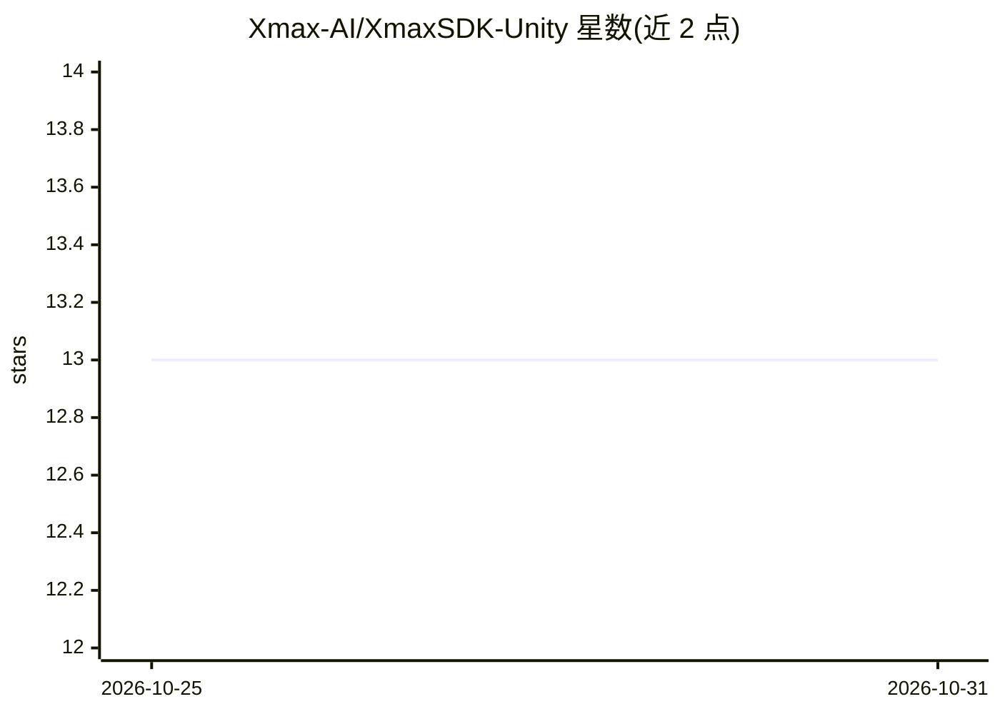

# Xmax-AI/XmaxSDK-Unity

⭐ 13 · C# · MIT · 推送 2026-10-27 · [GitHub](https://github.com/Xmax-AI/XmaxSDK-Unity) · [官网](https://platform.xmax.ai/docs) · 组织维护

**面向 Unity 开发者的 Xmax 实时交互视频生成接入 SDK**

Unity 包形式分发的 SDK，接入 Xmax 模型实现端到端实时交互视频生成管线：媒体采集、视频流传输、逐帧生成与端上渲染，实现低延迟视频变换。端到端延迟为数百毫秒级，单张 RTX 5090 即可运行（对比数据中心 GPU），支持最高 1080p 实时生成。要求 Unity 6000.0+、Android ARM64 构建目标与 Xmax API key，依赖 Agora RTC SDK 实现低延迟实时视频通信。MIT 许可。

## 筛选速览

| 维度 | 判定 | 备注 |
|---|---|---|
| AI 角色 | `ai-ecosystem` | LLM/agent 周边工具 |
| 许可风险 | `permissive` | MIT |
| 部署形态 | `None` |  |
| 模型依赖 | — | README 未给出锁定关系 |
| 硬件要求 | — | 无带数字的原话,不猜 |
| 安装摩擦 | `low` | 无编译、无系统依赖或容器化 |
| 成熟度 | — | 结构信号不足 |

## 能力要点

- 覆盖采集、流传输、逐帧生成、端上渲染的端到端管线
- 端到端延迟数百毫秒，支持最高 1080p 实时生成
- 单张 RTX 5090 即可运行
- 以 Unity 包（UPM）形式分发，支持 PICO 设备的 ARM64 Android 运行时

## 适用场景

- 在 Unity 应用中集成实时 AI 视频变换能力
- 用前置摄像头将用户实时转换为参考图中的角色
- 在 PICO 等 Android ARM64 设备上构建实时生成应用

## 场景标签

`视频生成` · 领域:内容生成

## 证据(README 行号)

> L8: We introduce XmaxSDK, a Unity SDK designed for real-time interactive video generation via Xmax models. XmaxSDK imple
> L38: XmaxSDK is distributed as a Unity package. Add a local UPM dependency to

## 星数曲线

2026-10-25 13 → 2026-10-31 13（+0）

---
*卡片 v1 · prompt 1.4 · 生成 2026-10-31 · 置信度 high · 依据 README sha `edbc7b6b2da9` · [字段定义](../../DATASET.md)*
