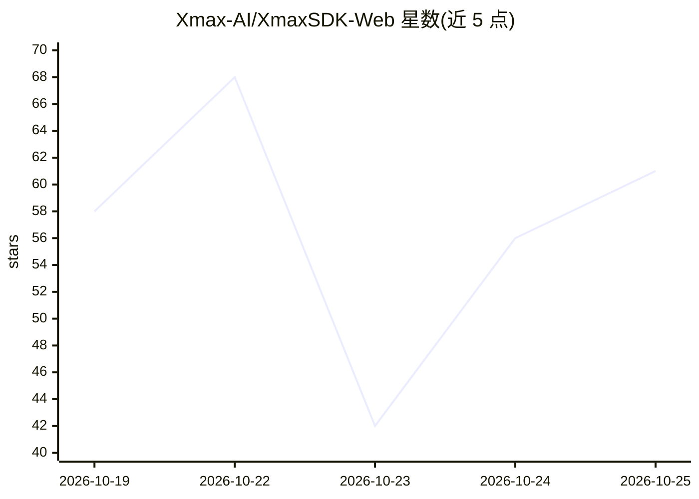

# Xmax-AI/XmaxSDK-Web

⭐ 62 · TypeScript · MIT · 推送 2026-10-21 · [GitHub](https://github.com/Xmax-AI/XmaxSDK-Web) · 组织维护 · 中文 README

**接入 Xmax 视频生成服务的 JavaScript Web SDK**

面向 Web 开发者的实时交互式视频生成 SDK，通过 Xmax API key 连接 Xmax 模型服务，实现媒体采集、视频流传输、逐帧生成与浏览器端渲染的端到端管线。支持摄像头或本地图片输入、鼠标/触控轨迹交互、约 20 秒生成片段录制（不重编码、64 MiB 缓冲上限）、React 组件与事件监听器，兼容 TRTC/Agora/VeRTC 的外部视频发布路径。运行需 Node.js 18+、WebRTC 浏览器与 Xmax API key；录制能力受浏览器格式支持限制，移动 Safari 上 TRTC 录音不可用。

## 筛选速览

| 维度 | 判定 | 备注 |
|---|---|---|
| AI 角色 | `ai-ecosystem` | LLM/agent 周边工具 |
| 许可风险 | `permissive` | MIT |
| 部署形态 | `library` | 以包/库形式分发 |
| 模型依赖 | — | README 未给出锁定关系 |
| 硬件要求 | — | 无带数字的原话,不猜 |
| 安装摩擦 | `low` | 无编译、无系统依赖或容器化 |
| 成熟度 | — | 结构信号不足 |

## 能力要点

- 端到端管线：媒体采集、视频流、逐帧生成、浏览器端渲染
- 支持拖拽轨迹实时交互生成视频（鼠标/触控多点）
- 可选约 20 秒录制，视频帧全保留、音轨按包边界剪切
- 提供 React 组件（@xmaxai/web-sdk/react）与本地图片输入模式

## 适用场景

- 直播画面中实时替换角色、换装或转换视频风格
- 在直播摄像头画面中召唤虚拟角色并手势互动
- 通过画轨迹让静态图片中的角色动起来
- 为 Web 应用集成低延迟交互式视频生成功能

## 场景标签

`视频生成` · 领域:内容生成

## 证据(README 行号)

> L7: We introduce XmaxSDK, a JavaScript SDK designed for real-time interactive video generation via Xmax models. XmaxSDK 
> L106: - An Xmax API key

## 星数曲线

2026-10-19 58 → 2026-10-25 61（+3）

---
*卡片 v1 · prompt 1.4 · 生成 2026-10-24 · 置信度 high · 依据 README sha `11a41d894027` · [字段定义](../../DATASET.md)*
