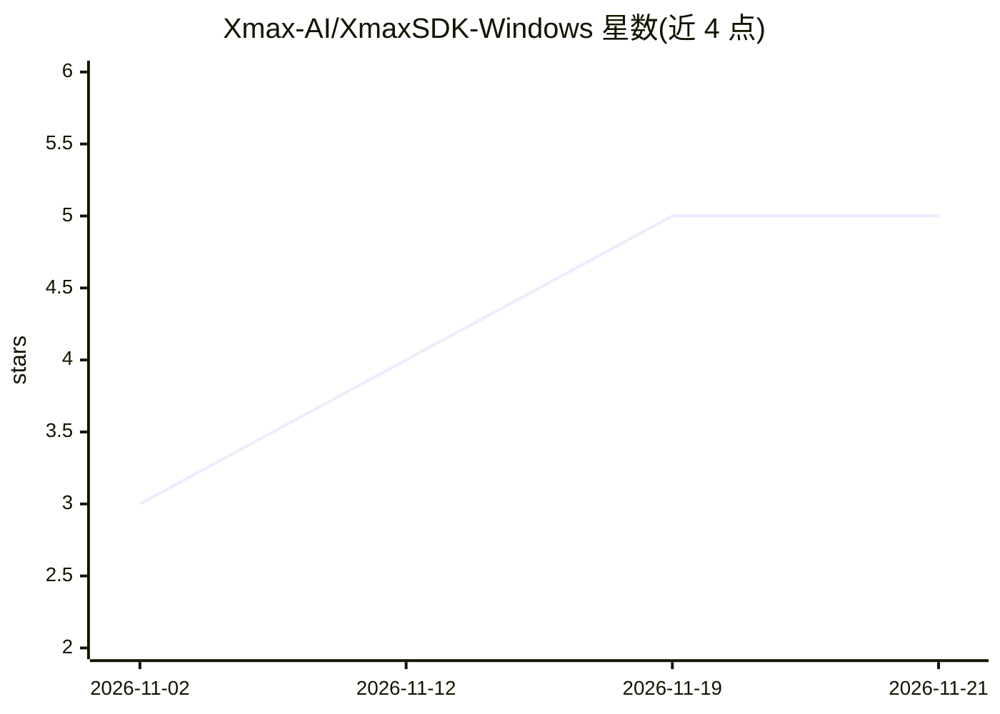

# Xmax-AI/XmaxSDK-Windows

⭐ 5 · C++ · MIT · 推送 2026-11-20 · [GitHub](https://github.com/Xmax-AI/XmaxSDK-Windows) · [官网](https://platform.xmax.ai/docs) · 组织维护 · 中文 README

**面向开发者的实时交互式视频生成 Windows SDK**

XmaxSDK 是接入 Xmax 模型的 Windows SDK，提供从媒体采集、视频流、逐帧生成到设备端渲染的端到端管线，供开发者将低延迟视频变换集成到创意应用中。提供 .NET（WinUI/WPF）与 C++（CMake）两种接入方式，默认实时模型为 X2.1，经 Agora 通道传输，支持角色替换、虚拟试衣、视频风格重绘、AI 伴侣等实时用例；需 API key 访问 Xmax 托管服务，输出最高 1080p。

## 筛选速览

| 维度 | 判定 | 备注 |
|---|---|---|
| AI 角色 | `ai-native` | 本体是模型或模型工具 |
| 许可风险 | `permissive` | MIT |
| 部署形态 | `None` |  |
| 模型依赖 | — | README 未给出锁定关系 |
| 硬件要求 | — | 无带数字的原话,不猜 |
| 安装摩擦 | `high` | 编译与系统依赖俱全 |
| 成熟度 | — | 结构信号不足 |

## 能力要点

- 端到端管线：媒体采集、视频流、逐帧生成、设备端渲染
- 提供 .NET（WinUI/WPF）与 C++（CMake/C API）接入方式
- 默认实时模型 X2.1 Flash，支持多种分辨率，704×1280 下 30 FPS
- 集成 Agora RTC 低延迟音视频通信与腾讯云 COS 对象存储

## 适用场景

- 直播画面中实时替换为指定角色
- 视频流中实时更换服装
- 将摄像头画面实时重绘为指定风格
- 在实时画面中加入可与手势交互的虚拟角色

## 场景标签

`视频生成` · 领域:内容生成

## 证据(README 行号)

> L9: We introduce XmaxSDK, a Windows SDK designed for real-time interactive video generation via Xmax models. XmaxSDK imp
> L125: The default realtime model is X2.1. Select `RealtimeModel.X2_1Flash` in .NET,

## 星数曲线

2026-11-02 3 → 2026-11-21 5（+2）

---
*卡片 v1 · prompt 1.4 · 生成 2026-11-21 · 置信度 high · 依据 README sha `105475cbd439` · [字段定义](../../DATASET.md)*
