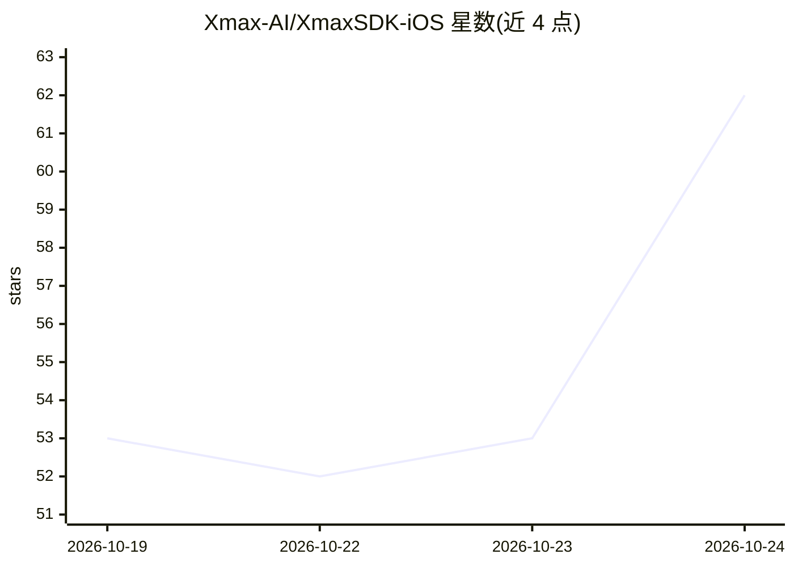

# Xmax-AI/XmaxSDK-iOS

⭐ 62 · Swift · MIT · 推送 2026-10-23 · [GitHub](https://github.com/Xmax-AI/XmaxSDK-iOS) · [官网](https://platform.xmaxai.com/docs) · 组织维护 · 中文 README

**面向 iOS 开发者的实时交互式视频生成 SDK（Xmax 模型客户端）**

XmaxSDK 是原生 iOS SDK（Swift 6，iOS 15.0+），用于接入 Xmax 模型实现实时交互式视频生成。实现端到端管线：媒体采集、视频流传输、逐帧生成与端上渲染，支持角色替换、虚拟试穿、视频风格化、AI 伴陪角色、Live Photo 动画等用例。需 Xmax API key（按量计费），依赖 Agora RTC SDK 与腾讯云 COS SDK；声称端到端延迟为数百毫秒、最高 1080p 实时生成。提供 Swift Package Manager、CocoaPods 与手动集成三种安装方式，附 UIKit/SwiftUI 示例工程。

## 筛选速览

| 维度 | 判定 | 备注 |
|---|---|---|
| AI 角色 | `ai-ecosystem` | LLM/agent 周边工具 |
| 许可风险 | `permissive` | MIT |
| 部署形态 | `None` |  |
| 模型依赖 | — | README 未给出锁定关系 |
| 硬件要求 | — | 无带数字的原话,不猜 |
| 安装摩擦 | `low` | 无编译、无系统依赖或容器化 |
| 成熟度 | — | 结构信号不足 |

## 能力要点

- 端到端管线：采集、推流、逐帧生成与端上渲染
- 支持角色替换/虚拟试穿/风格化/AI 伴陪/Live Photo 等实时用例
- 提供 SPM、CocoaPods、手动 xcframework 三种安装方式
- UIKit 与 SwiftUI 双实现示例工程与事件监听接口

## 适用场景

- 在 iOS 应用中加入实时摄像头视频的角色替换或换装功能
- 为直播/创意应用接入低延迟 AI 视频风格化
- 通过绘制轨迹让静态图片中角色动起来

## 场景标签

`视频生成` · 领域:内容生成

## 证据(README 行号)

> L8: We introduce XmaxSDK, a native iOS SDK designed for real-time interactive video generation via Xmax models. XmaxSDK 
> L108: - An Xmax API key

## 星数曲线

2026-10-19 53 → 2026-10-24 62（+9）

---
*卡片 v1 · prompt 1.4 · 生成 2026-10-24 · 置信度 high · 依据 README sha `3f83c80cc944` · [字段定义](../../DATASET.md)*
