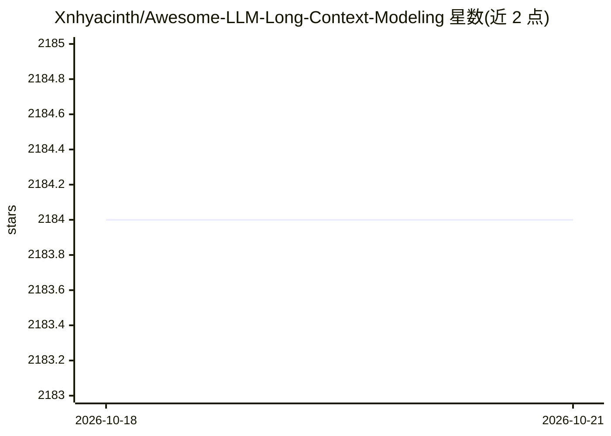

# Xnhyacinth/Awesome-LLM-Long-Context-Modeling

⭐ 2,184 · MIT · 推送 2026-08-17 · [GitHub](https://github.com/Xnhyacinth/Awesome-LLM-Long-Context-Modeling) · [官网](https://arxiv.org/abs/2503.17407) · 个人维护

**LLM 长上下文建模论文与博客的策展清单**

收录长上下文语言建模领域的论文与技术博客的 Awesome 清单，主题覆盖综述、高效注意力、KV cache 优化、位置编码与长度外推、长上下文训练、长期记忆、RAG、上下文压缩、长 CoT、长视频、长程 agent、评测基准与技术报告等类别。以周为单位更新 Week Papers 条目，并与 LCLM-Horizon 合作维护一份长上下文建模学术综述（arXiv:2503.17407），README 中给出该综述的引用格式。面向从事长上下文建模研究的科研人员与开发者。

## 筛选速览

| 维度 | 判定 | 备注 |
|---|---|---|
| AI 角色 | `ai-knowledge` | 知识聚合/清单类 |
| 许可风险 | `permissive` | MIT |
| 部署形态 | `None` |  |
| 模型依赖 | — | README 未给出锁定关系 |
| 硬件要求 | — | 无带数字的原话,不猜 |
| 安装摩擦 | `low` | 无编译、无系统依赖或容器化 |
| 成熟度 | — | 结构信号不足 |

## 能力要点

- 按 18 个左右主题类别组织长上下文建模论文与博客
- 按日期持续更新 Week Papers 条目
- 关联合作维护的学术综述《A Comprehensive Survey on Long Context Language Modeling》
- 提供 mermaid 分类图概览整个领域结构

## 适用场景

- 查找长上下文建模各子方向（KV cache、长程记忆、压缩等）的论文
- 跟踪该领域每周新发表的论文与博客
- 作为长上下文建模入门的分类导航

## 场景标签

`精选清单` `科研工具` · 领域:学习与行业

## 证据(README 行号)

> L1: # Large Language Model Based Long Context Modeling Papers and Blogs
> L19: This repository curates papers and blogs on long-context language modeling, covering surveys; efficient attention; 
> L21: 🔥 Must-read papers for LLM-based Long Context Modeling.

## 星数曲线

2026-10-18 2,184 → 2026-10-21 2,184（+0）

---
*卡片 v1 · prompt 1.4 · 生成 2026-10-21 · 置信度 high · 依据 README sha `1091771f9e0d` · [字段定义](../../DATASET.md)*
