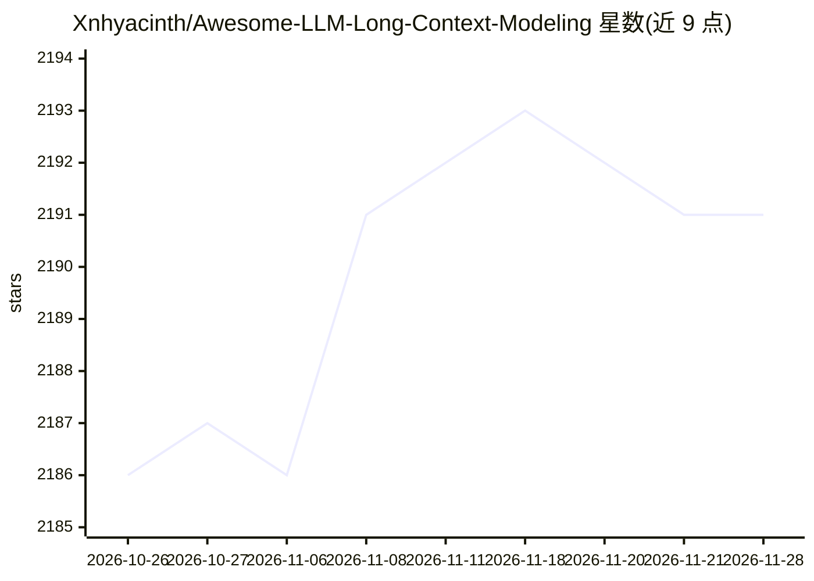

# Xnhyacinth/Awesome-LLM-Long-Context-Modeling

⭐ 2,191 · MIT · 推送 2026-11-27 · [GitHub](https://github.com/Xnhyacinth/Awesome-LLM-Long-Context-Modeling) · [官网](https://arxiv.org/abs/2503.17407) · 个人维护

**长上下文 LLM 建模论文与博客的策展清单**

以清单形式收录长上下文语言建模方向的论文与博客，按分类体系组织：高效注意力与 KV 缓存、循环 transformer 与状态空间模型、位置编码与长度外推、长上下文训练、长期记忆、RAG、上下文压缩、长推理（long CoT）、长视频与图像、长程 agent、基准评测等。仓库配套一篇 arXiv 综述（arXiv:2503.17407）与 mermaid 分类图，并以周/月为单位滚动更新新增论文条目。无代码与安装环节。

## 筛选速览

| 维度 | 判定 | 备注 |
|---|---|---|
| AI 角色 | `ai-knowledge` | 知识聚合/清单类 |
| 许可风险 | `permissive` | MIT |
| 部署形态 | `None` |  |
| 模型依赖 | — | README 未给出锁定关系 |
| 硬件要求 | — | 无带数字的原话,不猜 |
| 安装摩擦 | `low` | 无编译、无系统依赖或容器化 |
| 成熟度 | — | 结构信号不足 |

## 能力要点

- 覆盖高效注意力、KV 缓存、长度外推、长期记忆、长视频等多个子主题的论文分类
- 配套 arXiv 综述论文（arXiv:2503.17407）
- mermaid 流程图展示整体分类体系
- 以周为单位滚动更新论文条目

## 适用场景

- 查找长上下文建模方向必读论文的研究者
- 跟踪 KV 缓存压缩、稀疏注意力等子方向最新进展
- 调研长上下文基准与评测相关工作

## 场景标签

`精选清单` · 领域:学习与行业

## 证据(README 行号)

> L1: # Large Language Model Based Long Context Modeling Papers and Blogs
> L19: This repository curates papers and blogs on long-context language modeling, covering surveys; efficient attention; 
> L3: 📝 Survey Paper |

## 星数曲线

2026-10-26 2,186 → 2026-11-28 2,191（+5）

---
*卡片 v1 · prompt 1.4 · 生成 2026-11-28 · 置信度 high · 依据 README sha `c1aeb68bca76` · [字段定义](../../DATASET.md)*
