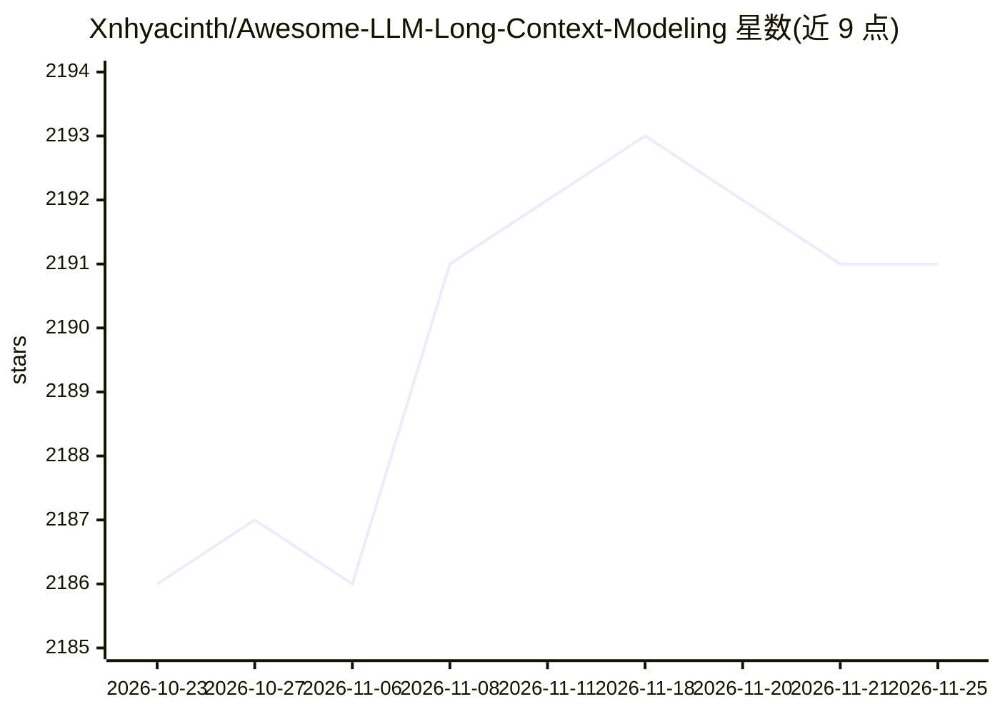

# Xnhyacinth/Awesome-LLM-Long-Context-Modeling

⭐ 2,191 · MIT · 推送 2026-11-13 · [GitHub](https://github.com/Xnhyacinth/Awesome-LLM-Long-Context-Modeling) · [官网](https://arxiv.org/abs/2503.17407) · 个人维护

**面向研究者的长上下文语言建模论文/博客精选清单**

该仓库按主题整理长上下文语言建模相关的论文与博客，覆盖高效注意力、KV-cache 优化、循环 Transformer 与状态空间模型、位置编码与长度外推、长期记忆、检索增强生成、上下文压缩、长推理、长视频理解、基准评测及技术报告等方向。内容按周/月滚动更新，附分类图与配套 arXiv 综述论文，供研究人员查阅与引用。仓库本身不包含代码，仅提供文献索引。

## 筛选速览

| 维度 | 判定 | 备注 |
|---|---|---|
| AI 角色 | `ai-knowledge` | 知识聚合/清单类 |
| 许可风险 | `permissive` | MIT |
| 部署形态 | `None` |  |
| 模型依赖 | — | README 未给出锁定关系 |
| 硬件要求 | — | 无带数字的原话,不猜 |
| 安装摩擦 | `low` | 无编译、无系统依赖或容器化 |
| 成熟度 | — | 结构信号不足 |

## 能力要点

- 按周/月更新的论文清单，覆盖 16+ 长上下文子方向
- 提供 mermaid 分类图与配套 arXiv 综述（2503.17407）
- 条目含论文链接与 GitHub 仓库信息

## 适用场景

- 查找长上下文建模方向的必读论文
- 跟踪 KV cache、长度外推等子方向的最新进展
- 撰写综述或调研时作为文献索引起点

## 场景标签

`精选清单` · 领域:学习与行业

## 证据(README 行号)

> L19: This repository curates papers and blogs on long-context language modeling, covering surveys; efficient attention; 
> L21: 🔥 Must-read papers for LLM-based Long Context Modeling.

## 星数曲线

2026-10-23 2,186 → 2026-11-25 2,191（+5）

---
*卡片 v1 · prompt 1.4 · 生成 2026-11-23 · 置信度 high · 依据 README sha `aee2d24f10e9` · [字段定义](../../DATASET.md)*
