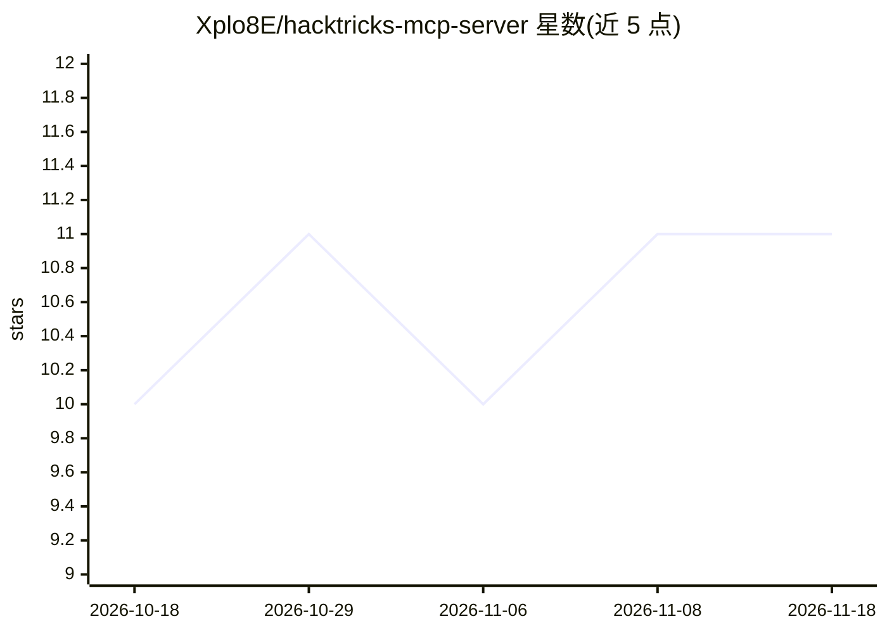

# Xplo8E/hacktricks-mcp-server

⭐ 11 · JavaScript · MIT · 推送 2026-03-28 · [GitHub](https://github.com/Xplo8E/hacktricks-mcp-server) · 个人维护

**将 HackTricks 渗透测试知识接入 Claude Desktop 的 MCP 检索服务器**

基于 MCP 协议的服务器，让 Claude Desktop 直接搜索 HackTricks 渗透测试文档，收录 1000+ 安全技术、漏洞利用与 payload。提供 7 个专用工具：别名速查（sqli/xss/ssrf 等）、按文件分组的搜索、页面大纲、按标题提取章节、纯代码块速查表、全文读取、类别浏览。依赖 ripgrep 实现即时搜索，通过分步检索模式降低 token 消耗，并含命令注入与路径遍历防护。安装后需在 Claude Desktop 配置中注册方可使用。

## 筛选速览

| 维度 | 判定 | 备注 |
|---|---|---|
| AI 角色 | `ai-ecosystem` | LLM/agent 周边工具 |
| 许可风险 | `permissive` | MIT |
| 部署形态 | `library` | 以包/库形式分发 |
| 模型依赖 | — | README 未给出锁定关系 |
| 硬件要求 | — | 无带数字的原话,不猜 |
| 安装摩擦 | `low` | 无编译、无系统依赖或容器化 |
| 成熟度 | — | 结构信号不足 |

## 能力要点

- 7 个 MCP 工具覆盖速查、搜索、大纲、章节提取、速查表等检索方式
- 支持 sqli/xss/ssrf 等 13 种攻击技术别名的一键速查
- 分步检索模式（搜索→大纲→章节→速查表）降低 token 消耗
- 针对命令注入与路径遍历的安全防护

## 适用场景

- 渗透测试时在 Claude 中直接查询漏洞利用方法与 payload
- 按类别浏览 HackTricks 主题结构定位相关章节
- 快速提取提权、注入等场景的命令清单

## 场景标签

`网络安全` · 领域:学习与行业

## 证据(README 行号)

> L3: MCP (Model Context Protocol) server for searching and querying HackTricks pentesting documentation directly from Cla
> L68: The server provides 7 specialized tools for efficient HackTricks searching.
> L225: - Built with Model Context Protocol SDK

## 星数曲线

2026-10-18 10 → 2026-11-18 11（+1）

---
*卡片 v1 · prompt 1.4 · 生成 2026-11-18 · 置信度 high · 依据 README sha `a9dcb23a1039` · [字段定义](../../DATASET.md)*
