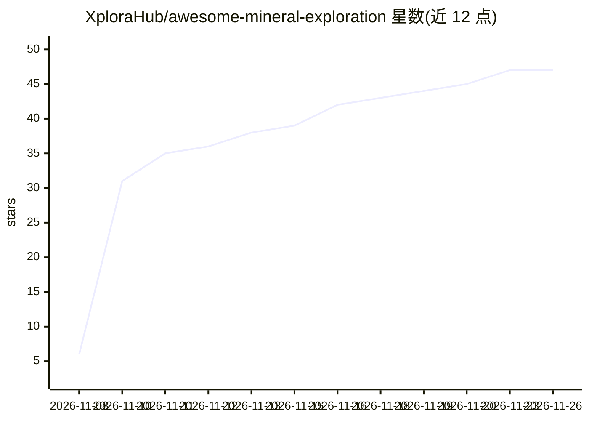

# XploraHub/awesome-mineral-exploration

⭐ 47 · CC0-1.0 · 推送 2026-11-24 · [GitHub](https://github.com/XploraHub/awesome-mineral-exploration) · [官网](https://xplorahub.com) · 组织维护

**矿产勘探开源软件策展清单：地球物理、地质建模、钻探等地学工具**

由 XploraHub 维护的矿产勘探领域开源软件清单（Awesome List），收录条目覆盖地球物理正反演、三维地质建模、钻孔数据处理与解斜、地质统计学与克里金、地球化学、高光谱遥感、成矿预测与机器学习等类别，并附各国政府地学开放数据门户。收录标准为：开源、有许可证、近 18 个月内有更新（末尾单列不再维护条目）；每条标注主要语言与许可证。列表以 CC0 许可发布。

## 筛选速览

| 维度 | 判定 | 备注 |
|---|---|---|
| AI 角色 | `ai-knowledge` | 知识聚合/清单类 |
| 许可风险 | `viral` | CC0-1.0 |
| 部署形态 | `None` |  |
| 模型依赖 | — | README 未给出锁定关系 |
| 硬件要求 | — | 无带数字的原话,不猜 |
| 安装摩擦 | `low` | 无编译、无系统依赖或容器化 |
| 成熟度 | — | 结构信号不足 |

## 能力要点

- 覆盖地球物理、地质建模、钻孔、地质统计、地球化学、遥感、成矿预测等类别
- 收录标准：开源、有许可证、18 个月内有更新
- 附各国政府地学开放数据门户（澳大利亚、美国、加拿大等）
- 条目标注主要编程语言与许可证

## 适用场景

- 为矿产勘探项目寻找各环节可用的开源工具
- 了解成矿预测与机器学习方向有哪些开源实现
- 查找各国政府地学数据门户作为数据来源

## 场景标签

`精选清单` · 领域:学习与行业

## 证据(README 行号)

> L13: A curated list of open-source software for mineral exploration: geophysics, geological modelling, drillholes, geost
> L15: Every tool here is open source, has a licence and has been updated in the last 18 months, except those under No lon

## 星数曲线

2026-11-08 6 → 2026-11-26 47（+41）

---
*卡片 v1 · prompt 1.4 · 生成 2026-11-18 · 置信度 mid · 依据 README sha `ba2a5d40dcae` · [字段定义](../../DATASET.md)*
