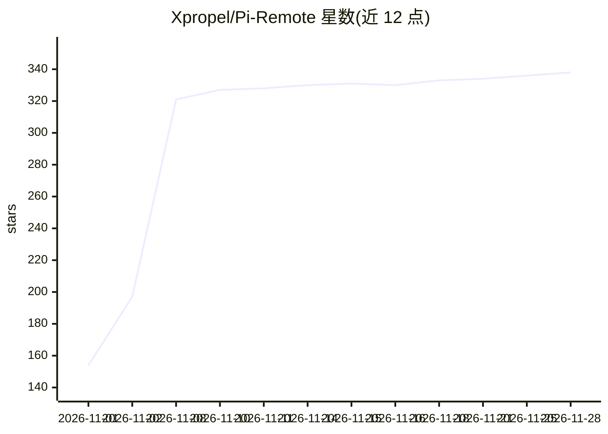

# Xpropel/Pi-Remote

⭐ 338 · TypeScript · MIT · 推送 2026-11-22 · [GitHub](https://github.com/Xpropel/Pi-Remote) · 个人维护 · 中文 README

**在浏览器/手机上远程查看与操控 pi 编码 agent 会话的工具**

通过 pi 官方扩展 API 附加到本地运行的 pi 终端会话，将输出、工具调用与状态实时镜像到浏览器，可从手机发送消息与命令（切换模型、调整思考等级、压缩上下文、创建/切换会话树）。架构分三部分：运行于 pi 进程内的同步扩展、自托管的 Node 中继（不持有模型凭据与本地文件）、以及由中继提供的 Web UI。支持二维码配对多设备、局域网无服务器模式与 Cloudflare Tunnel 临时公网。要求 Node ≥ 22.18，设计为单用户使用，无多用户权限体系。

## 筛选速览

| 维度 | 判定 | 备注 |
|---|---|---|
| AI 角色 | `ai-ecosystem` | LLM/agent 周边工具 |
| 许可风险 | `permissive` | MIT |
| 部署形态 | `self-host` | docker 或自建部署 |
| 模型依赖 | — | README 未给出锁定关系 |
| 硬件要求 | — | 无带数字的原话,不猜 |
| 安装摩擦 | `low` | 无编译、无系统依赖或容器化 |
| 成熟度 | — | 结构信号不足 |

## 能力要点

- 实时镜像会话并在重连后增量补齐输出
- 远程发送消息与命令：切换模型/思考等级、压缩上下文、管理会话树
- 自托管中继 + 端到端加密，二维码扫码配对设备
- 支持局域网无服务器模式与 Cloudflare Tunnel 临时公网访问

## 适用场景

- 离开电脑时用手机查看并继续 pi 编码会话
- 在多台机器间通过一个中继统一查看设备与会话列表
- 局域网内免服务器地把终端会话镜像到浏览器

## 场景标签

`编码 Agent` · 领域:编码与开发

## 证据(README 行号)

> L13: Pi-Remote attaches to a running pi session through pi's official extension API. It does not modify pi's source code
> L15: > **Relationship to pi**: Pi-Remote is a companion tool built for pi, Earendil's terminal coding agent, on pi's off

## 星数曲线

2026-11-01 154 → 2026-11-28 338（+184）

---
*卡片 v1 · prompt 1.4 · 生成 2026-11-25 · 置信度 high · 依据 README sha `cf6606f7090e` · [字段定义](../../DATASET.md)*
