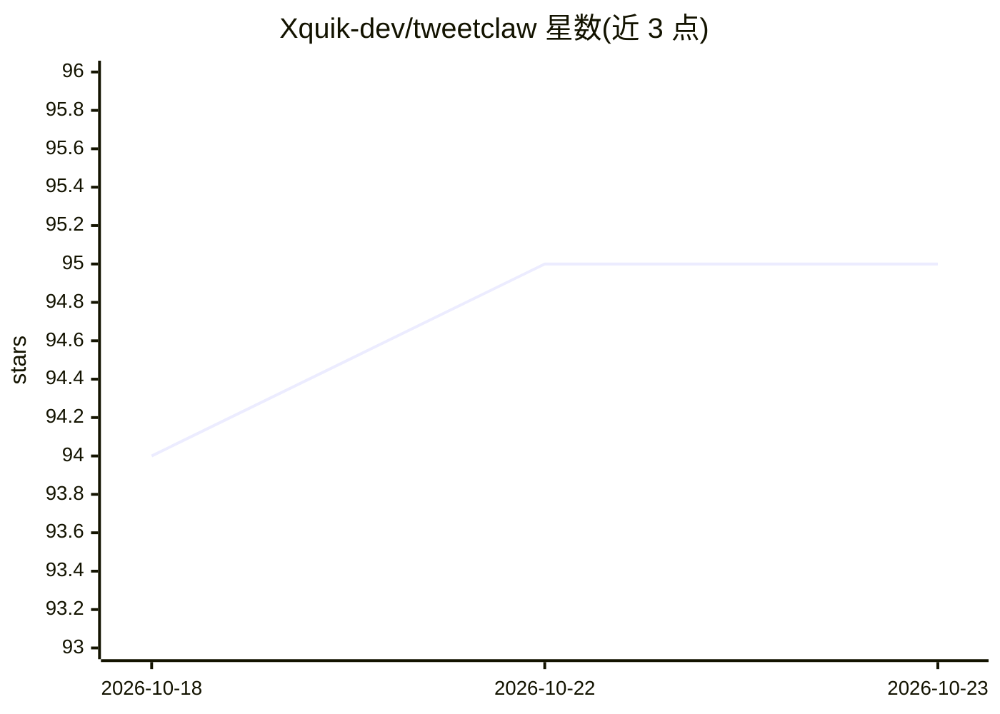

# Xquik-dev/tweetclaw

⭐ 95 · TypeScript · MIT · 推送 2026-10-21 · [GitHub](https://github.com/Xquik-dev/tweetclaw) · [官网](https://docs.xquik.com/guides/tweetclaw) · 组织维护

**OpenClaw 的 X/Twitter 操作插件：让 agent 搜推、发帖、导粉丝、监控**

面向 OpenClaw agent 框架的 Twitter/X 插件，通过第三方 Xquik 抓取与 API 服务执行推文搜索、时间线读取、粉丝/关注导出、账号与关键词监控（60 秒轮询）、发帖/回复/点赞/DM 等写操作。写类、私密与付费调用均触发 OpenClaw 逐次审批提示；附带免费本地 explore 目录工具与 SKILL.md 技能安装。计费依赖 Xquik 账户订阅、预付积分或 MPP 无账户按次付费。声明与 X Corp 无关。

## 筛选速览

| 维度 | 判定 | 备注 |
|---|---|---|
| AI 角色 | `ai-ecosystem` | LLM/agent 周边工具 |
| 许可风险 | `permissive` | MIT |
| 部署形态 | `library` | 以包/库形式分发 |
| 模型依赖 | — | README 未给出锁定关系 |
| 硬件要求 | — | 无带数字的原话,不猜 |
| 安装摩擦 | `low` | 无编译、无系统依赖或容器化 |
| 成熟度 | — | 结构信号不足 |

## 能力要点

- 156 个 OpenAPI 操作经 tweetclaw 工具调用，覆盖搜索、导出、监控、发帖等
- 写类/私密/付费调用逐次审批，explore 免费离线目录
- 支持账户 API key、预付积分与 MPP（无账户按次付费）三种访问方式
- SKILL.md 可经 skills.sh 安装为 OpenClaw 技能

## 适用场景

- 让 OpenClaw agent 按关键词搜索推文或读取用户时间线
- 导出某账号的粉丝/关注列表
- 监控账号或关键词的新推文并接收事件通知
- 经审批后由 agent 代发推文、回复或抽奖操作

## 场景标签

`网页抓取` · 领域:效率与自动化

## 证据(README 行号)

> L11: TweetClaw is the Twitter bot plugin for OpenClaw. It runs on Xquik. Its packaged `SKILL.md` also installs as an Ope
> L17: Your agent can post, reply, search tweets, export followers & monitor accounts.

## 星数曲线

2026-10-18 94 → 2026-10-23 95（+1）

---
*卡片 v1 · prompt 1.4 · 生成 2026-10-23 · 置信度 mid · 依据 README sha `d38dc3c448d0` · [字段定义](../../DATASET.md)*
