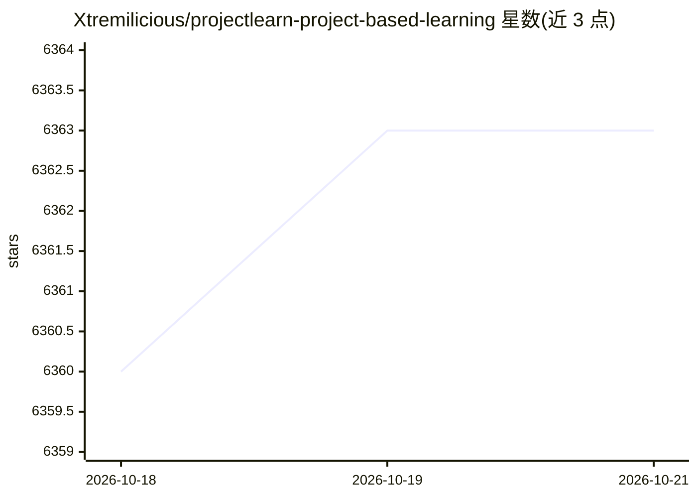

# Xtremilicious/projectlearn-project-based-learning

⭐ 6,363 · TypeScript · MIT · 推送 2026-05-30 · [GitHub](https://github.com/Xtremilicious/projectlearn-project-based-learning) · [官网](https://projectlearn.io) · 个人维护

**项目式学习教程策展清单：从零构建应用的分类项目目录**

一个由社区维护的精选教程列表，收录从零构建应用的项目式学习教程，按 Web 开发、移动开发、游戏开发分类组织（README 声明还涵盖机器学习、深度学习与人工智能分类，本文可见部分未展示）。每个条目列出项目名称、所用技术栈与教程链接，技术栈覆盖 React、Vue、Flutter、Unity、Godot、TensorFlow 等。通过 CONTRIBUTE.md 接受 PR 贡献，MIT 许可证发布。本体为纯清单，无可安装的软件产物。

## 筛选速览

| 维度 | 判定 | 备注 |
|---|---|---|
| AI 角色 | `ai-knowledge` | 知识聚合/清单类 |
| 许可风险 | `permissive` | MIT |
| 部署形态 | `None` |  |
| 模型依赖 | — | README 未给出锁定关系 |
| 硬件要求 | — | 无带数字的原话,不猜 |
| 安装摩擦 | `low` | 无编译、无系统依赖或容器化 |
| 成熟度 | — | 结构信号不足 |

## 能力要点

- 按 Web/移动/游戏开发等分类组织的项目教程清单
- 每个条目标注项目名、技术栈与教程链接
- 覆盖 React、Vue、Flutter、Unity、Godot、TensorFlow 等技术栈
- 通过 PR 接受社区贡献，MIT 许可证

## 适用场景

- 开发者通过从零构建克隆应用来学习新技术栈
- 按技术栈（React/Flutter/Unity 等）查找练手项目教程
- 初学者按分类浏览项目式学习路径

## 场景标签

`教程课程` `精选清单` · 领域:学习与行业

## 证据(README 行号)

> L17: ProjectLearn provides a curated list of project tutorials in which learners build an application from scratch. Thes
> L19: The list has project tutorials on many in-demand languages and technologies including ReactJS, NodeJS, VueJS, Flutt

## 星数曲线

2026-10-18 6,360 → 2026-10-21 6,363（+3）

---
*卡片 v1 · prompt 1.4 · 生成 2026-10-20 · 置信度 high · 依据 README sha `0bd86cae30cb` · [字段定义](../../DATASET.md)*
