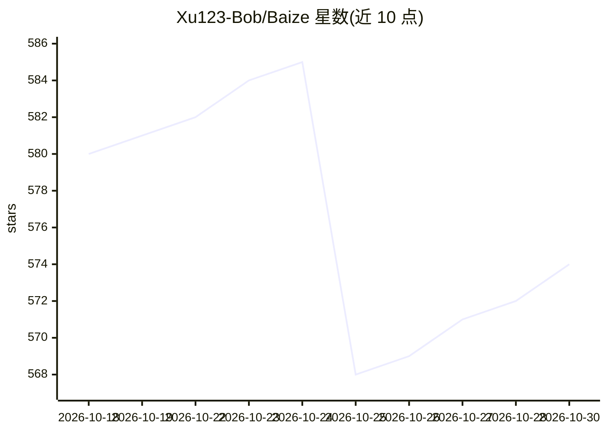

# Xu123-Bob/Baize

⭐ 574 · JavaScript · MIT · 推送 2026-10-24 · [GitHub](https://github.com/Xu123-Bob/Baize) · 个人维护 · 中文 README

**带隐私脱敏的开源 Coding Agent CLI，支持多后端**

面向开发者的命令行 AI 编码与数据分析助手：支持 DeepSeek、OpenAI 兼容端点（GLM/Qwen/Kimi/OpenAI）及本地 Ollama 等后端，提供工具调用、技能加载、子代理委派、上下文压缩与安全沙箱。核心机制是双向可逆隐私脱敏：30+ 类敏感信息在发送给 LLM 前替换为加密随机占位符，响应后自动还原，写盘文件同样脱敏；本地运行、无远程数据库。可选安装 SPSS 与 SQL 数据库访问依赖（需本地已装 IBM SPSS 或 ODBC 驱动，属系统级前置）。

## 筛选速览

| 维度 | 判定 | 备注 |
|---|---|---|
| AI 角色 | `ai-native` | 本体是模型或模型工具 |
| 许可风险 | `permissive` | MIT |
| 部署形态 | `desktop` | 安装包/桌面程序 |
| 模型依赖 | local-ok | 支持本地模型 |
| 硬件要求 | — | 无带数字的原话,不猜 |
| 安装摩擦 | `low` | 无编译、无系统依赖或容器化 |
| 成熟度 | — | 结构信号不足 |

## 能力要点

- 发送 LLM 前对 30+ 类敏感信息做占位符脱敏，响应后自动还原
- 多后端支持：DeepSeek/OpenAI 兼容/Zhipu/通义/Kimi/本地 Ollama
- 技能（SKILL.md）、子代理、Hooks、MCP 协议四类扩展机制
- 命令允许表、路径逃逸检测等安全沙箱与二级上下文压缩

## 适用场景

- 在本地 CLI 中用自然语言驱动编码、改码与数据分析任务
- 处理含敏感信息（手机号、API key 等）的代码时避免泄露给云端 LLM
- 通过自然语言驱动本地 SPSS 或 SQL 数据库做统计分析

## 场景标签

`编码 Agent` `数据分析` · 领域:效率与自动化

## 证据(README 行号)

> L44: **An open-source Coding Agent CLI with strong privacy protection and multilingual interaction. It supports multiple
> L58: - **Multi-backend support**: DeepSeek, any OpenAI-compatible endpoint (GLM / Qwen / Kimi / OpenAI), and local Ollam

## 星数曲线

2026-10-18 580 → 2026-10-30 574（-6）

---
*卡片 v1 · prompt 1.4 · 生成 2026-10-21 · 置信度 high · 依据 README sha `e18b45be91ff` · [字段定义](../../DATASET.md)*
