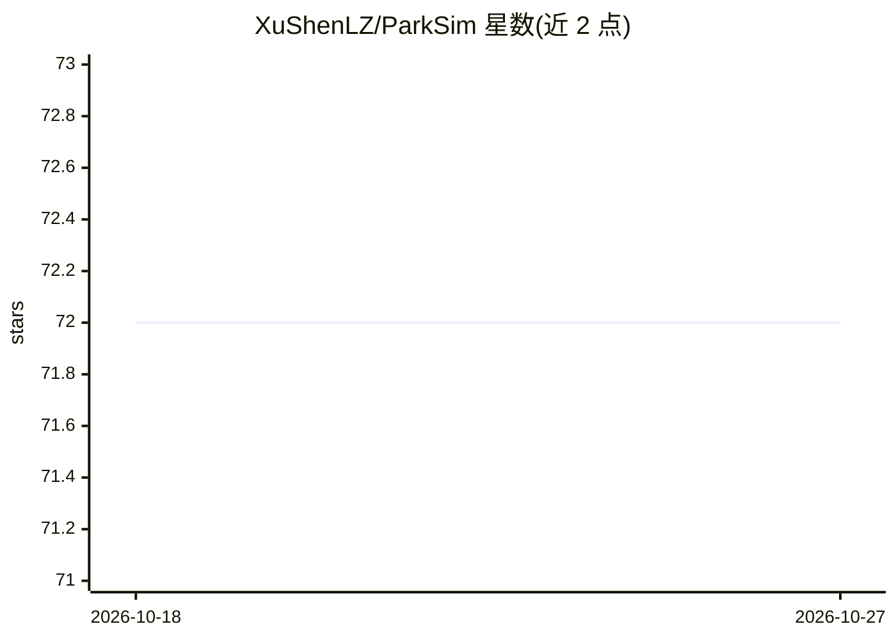

# XuShenLZ/ParkSim

⭐ 72 · Jupyter Notebook · GPL-3.0 · 推送 2025-11-12 · [GitHub](https://github.com/XuShenLZ/ParkSim) · 组织维护

**停车场车辆仿真与行为预测研究工具集**

Berkeley 团队维护的 monorepo，含两个子项目：ParkPredict+ 用 CNN 与 Transformer 做停车场内车辆的多模态意图与轨迹预测，提供可下载的预训练模型及评估 notebook；Fleet Parking 做网联自动驾驶车辆的停车分配、控制与多智能体仿真，需配合 DLP 数据集仓库运行，通过 pip install -e 从源码安装，可修改 yaml 配置仿真设置。README 注明 ROS 相关代码与项目开发不同步。

## 筛选速览

| 维度 | 判定 | 备注 |
|---|---|---|
| AI 角色 | `ai-native` | 本体是模型或模型工具 |
| 许可风险 | `viral` | GPL-3.0 |
| 部署形态 | `library` | 以包/库形式分发 |
| 模型依赖 | — | README 未给出锁定关系 |
| 硬件要求 | — | 无带数字的原话,不猜 |
| 安装摩擦 | `low` | 无编译、无系统依赖或容器化 |
| 成熟度 | — | 结构信号不足 |

## 能力要点

- CNN+Transformer 的多模态意图与运动预测
- 提供预训练意图与轨迹预测模型下载
- 多智能体泊车分配与控制仿真
- 基于 DLP 数据集（无人机采集的停车场轨迹数据）

## 适用场景

- 研究停车场场景的车辆行为与轨迹预测
- 搭建自动驾驶泊车分配与控制的多智能体仿真
- 评估或复训已有的意图/轨迹预测模型

## 场景标签

`科研工具` · 领域:学习与行业

## 证据(README 行号)

> L3: Vehicle simualtion and behavior prediction in parking lots. This is a monorepo with different projects mixed-in.
> L9: ParkPredict+: Multimodal Intent and Motion Prediction for Vehicles in Parking Lots with CNN and Transformer

## 星数曲线

2026-10-18 72 → 2026-10-27 72（+0）

---
*卡片 v1 · prompt 1.4 · 生成 2026-10-24 · 置信度 mid · 依据 README sha `a3bcf87af13e` · [字段定义](../../DATASET.md)*
