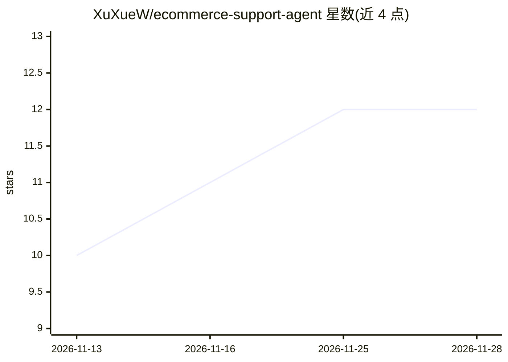

# XuXueW/ecommerce-support-agent

⭐ 12 · Python · MIT · 推送 2026-08-03 · [GitHub](https://github.com/XuXueW/ecommerce-support-agent) · 个人维护 · 中文 README

**面向电商客服的政策问答与工单协同 Agent 项目**

以电商客服为场景的 AI 应用工程示例：用 LangGraph 编排政策检索、订单查询、退款判断、工单创建 4 类工具，Qwen Function Calling 驱动多轮对话，含 Checkpoint、Human-in-the-loop 确认与中断恢复；检索侧为 BGE+Chroma 的词法/向量混合 RAG，带相关度拒答机制；订单数据迁移至 MySQL 并做身份校验与幂等写入；提供 72 条 RAG 评测与 34 条业务验收用例。项目定位为本地学习与作品展示，未上生产环境。

## 筛选速览

| 维度 | 判定 | 备注 |
|---|---|---|
| AI 角色 | `ai-native` | 本体是模型或模型工具 |
| 许可风险 | `permissive` | MIT |
| 部署形态 | `desktop` | 安装包/桌面程序 |
| 模型依赖 | — | README 未给出锁定关系 |
| 硬件要求 | — | 无带数字的原话,不猜 |
| 安装摩擦 | `low` | 无编译、无系统依赖或容器化 |
| 成熟度 | — | 结构信号不足 |

## 能力要点

- LangGraph 编排 4 类工具，支持多轮对话、Checkpoint 与 HITL 确认
- 16 类电商政策的 BGE + Chroma 混合 RAG 与越界拒答
- 72 条分层检索评测与 34 条确定性业务验收用例
- Docker Compose 编排 5 个组件，默认提供离线 Mock Agent 免 Key 演示

## 适用场景

- 本地学习电商客服 Agent 的编排与评测方法
- 复现 RAG 检索效果对比与越界拒答实验
- 基于 Olist 匿名订单数据演示订单查询与工单流程

## 场景标签

`RAG` `聊天机器人` · 领域:对话与助手

## 证据(README 行号)

> L3: 一个面向电商客服场景的 AI 应用工程项目，覆盖政策问答、订单查询、退款资格判断和
> L11: - 使用 LangGraph 和 Qwen Function Calling 编排政策检索、订单查询、退款判断、工单创建
> L13: - 构建覆盖 16 类电商政策的 BGE + Chroma 混合 RAG，融合词法检索和向量检索，并加入

## 星数曲线

2026-11-13 10 → 2026-11-28 12（+2）

---
*卡片 v1 · prompt 1.4 · 生成 2026-11-18 · 置信度 high · 依据 README sha `3034dd68cefc` · [字段定义](../../DATASET.md)*
