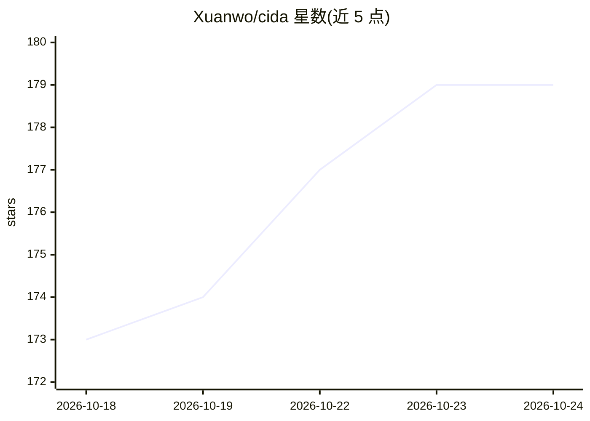

# Xuanwo/cida

⭐ 179 · Swift · Apache-2.0 · 推送 2026-10-20 · [GitHub](https://github.com/Xuanwo/cida) · [官网](https://cida.xuanwo.io) · 个人维护 · 中文 README

**Mac 菜单栏应用：用自选大模型在系统任意处翻译与润色文字**

面向 Mac 用户的菜单栏文字处理工具：选中文本翻译（⌥A）、润色后原处替换（⌥F）、截图本机 OCR 识别后翻译（⌥S）、段落原处替换译文（⌥D）及整窗口持续翻译。支持 OpenAI Chat Completions、Responses 与 Anthropic Messages 接口，本机模型无需 Key；可自定义动作（提示词驱动）。API Key 存钥匙串，截图经 Apple Vision 本机识别。提供 DMG 安装包（需 macOS 15+）与内置命令行，Apache-2.0 许可。

## 筛选速览

| 维度 | 判定 | 备注 |
|---|---|---|
| AI 角色 | `ai-native` | 本体是模型或模型工具 |
| 许可风险 | `permissive` | Apache-2.0 |
| 部署形态 | `desktop` | 安装包/桌面程序 |
| 模型依赖 | locked-api |  |
| 硬件要求 | — | 无带数字的原话,不猜 |
| 安装摩擦 | `low` | 无编译、无系统依赖或容器化 |
| 成熟度 | — | 结构信号不足 |

## 能力要点

- 五种全局快捷键覆盖翻译、润色、截图翻译与原处/整窗翻译
- 支持 OpenAI 两种接口与 Anthropic Messages，兼容本机模型端点
- 截图经 Apple Vision 本机 OCR，图片不上传
- 内置命令行管理配置，API Key 仅从 stdin/file/env 读取并存钥匙串

## 适用场景

- 在浏览器、聊天等任意应用里选中即翻译成指定语言
- 润色外语写作并原处替换，可 ⌘Z 撤销
- 截图识别图中外文并翻译，图片不出本机
- 连续阅读外文长文时整窗口跟随滚动翻译

## 场景标签

`AI 写作` `AI 助手` · 领域:对话与助手

## 证据(README 行号)

> L5:  用你选择的大模型，在 Mac 的任何地方翻译和润色文字。
> L10: - **选中文字，按 ⌥ A 。** 面板带着选中的文字出现，并执行动作栏的第一项，默认是翻译。翻译时，其他语言都译成你的语言，默认简体中文，可以在设置里写成任何语言、方言或文体，比如粤语；你的语言译成「翻译成」后面写着的外语，默
> L44: API Key 不经过助手：它会请你复制 Key 后运行一条命令，Key 直接存进钥匙串。支持 OpenAI Chat Completions、Responses 与 Anthropic Messages 三种接口，在本机运行的模

## 星数曲线

2026-10-18 173 → 2026-10-24 179（+6）

---
*卡片 v1 · prompt 1.4 · 生成 2026-10-22 · 置信度 high · 依据 README sha `f86fd1b60052` · [字段定义](../../DATASET.md)*
