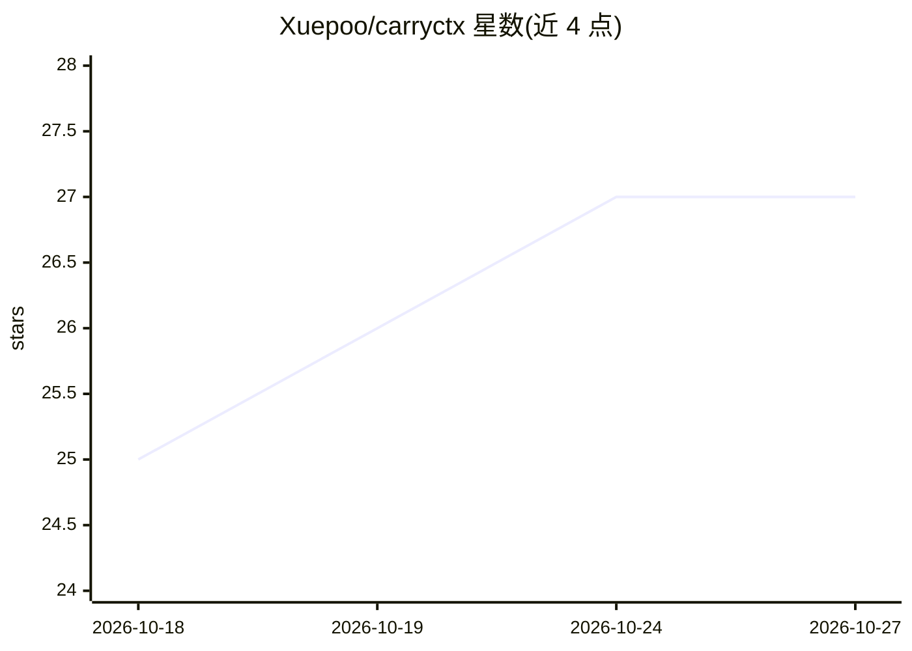

# Xuepoo/carryctx

⭐ 27 · Rust · MIT · 推送 2026-10-26 · [GitHub](https://github.com/Xuepoo/carryctx) · [官网](https://carryctx.xuepoo.xyz) · 个人维护 · 中文 README

**本地优先的编码代理项目状态持久化与管理 CLI**

基于 Rust + SQLite 的本地 CLI，为编码 agent 与人类协作者提供项目生命周期状态层：任务与依赖 DAG、agent/团队/角色注册、Git worktree 隔离、会话与检查点、审计式交接和 append-only 事件日志。明确自身不是 agent 运行时：进程调度、提示路由、模型选择仍由外部 harness（Claude Code、Copilot、Codex 等）负责。提供 Commander 四步工作流的 agent 技能 use-carryctx。安装途径含 Cargo、npm 包装、预编译二进制、Homebrew、Scoop。无云服务、遥测或托管账号。

## 筛选速览

| 维度 | 判定 | 备注 |
|---|---|---|
| AI 角色 | `ai-ecosystem` | LLM/agent 周边工具 |
| 许可风险 | `permissive` | MIT |
| 部署形态 | `desktop` | 安装包/桌面程序 |
| 模型依赖 | — | README 未给出锁定关系 |
| 硬件要求 | — | 无带数字的原话,不猜 |
| 安装摩擦 | `low` | 无编译、无系统依赖或容器化 |
| 成熟度 | — | 结构信号不足 |

## 能力要点

- SQLite 本地权威状态库，worktree 间共享
- 任务依赖 DAG、团队/角色/交接状态机与审计事件日志
- Git worktree 隔离执行与 fail-closed 清理策略
- agent 技能 use-carryctx：让 AI agent 担任 Commander 编排子 agent

## 适用场景

- 多 agent 编码项目中持久化任务、会话与团队状态，跨工具不丢失上下文
- 用隔离 worktree 分派子 agent 任务并验证交付
- 审计回溯项目决策、交接与事件历史

## 场景标签

`多智能体` `Agent 记忆` · 领域:Agent 开发

## 证据(README 行号)

> L7: CarryCtx is a persistence and control layer, not an agent runtime. Your external harness still launches agent proces
> L32: - **Agent-agnostic.** Claude Code, OpenCode, Copilot, Codex, another CLI harness, or a human can use the same CLI s

## 星数曲线

2026-10-18 25 → 2026-10-27 27（+2）

---
*卡片 v1 · prompt 1.4 · 生成 2026-10-26 · 置信度 high · 依据 README sha `b9531e4c783a` · [字段定义](../../DATASET.md)*
