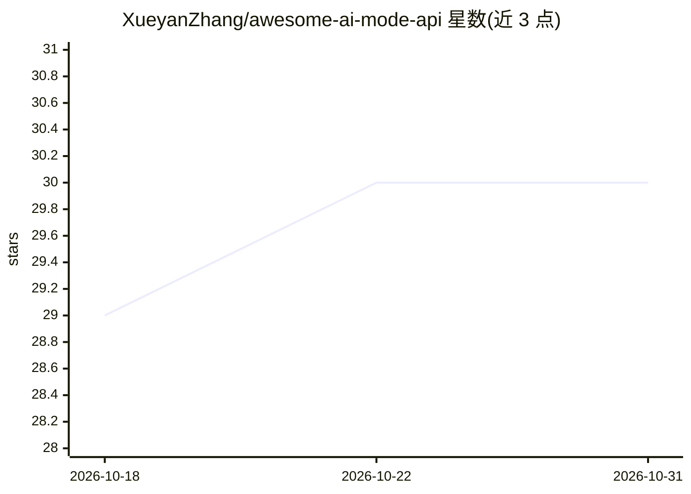

# XueyanZhang/awesome-ai-mode-api

⭐ 30 · MIT · 推送 2026-10-24 · [GitHub](https://github.com/XueyanZhang/awesome-ai-mode-api) · 个人维护 · 中文 README

**AI 模型 API 提供商与平台清单，含开源项目条目**

一个 curated 清单式仓库，收录 AI 模型 API 相关条目，分四节组织：API Providers（Anthropic、Azure OpenAI、OpenAI、Replicate、Stability.ai 等）、API Platform（AIWave、DeepInfra、Hugging Face、NLP Cloud、Together 等）、Open Source Projects（Llama 2 Chat、Ollama）、DIY（AWS、Google Cloud、Microsoft Azure）。每条目附 Home/Models/Pricing 链接，通过 issue 或 pull request 接受贡献。面向挑选模型 API 服务的开发者。

## 筛选速览

| 维度 | 判定 | 备注 |
|---|---|---|
| AI 角色 | `ai-knowledge` | 知识聚合/清单类 |
| 许可风险 | `permissive` | MIT |
| 部署形态 | `None` |  |
| 模型依赖 | — | README 未给出锁定关系 |
| 硬件要求 | — | 无带数字的原话,不猜 |
| 安装摩擦 | `low` | 无编译、无系统依赖或容器化 |
| 成熟度 | — | 结构信号不足 |

## 能力要点

- 按 API Providers / API Platform / 开源项目 / DIY 四类组织条目
- 每个条目附 Home、Models、Pricing 链接
- 覆盖 OpenAI 兼容网关类平台条目（如 AIWave、RunAPI、XiuRouter）

## 适用场景

- 挑选和比较模型 API 提供商
- 查找 OpenAI 兼容的 API 网关或平台
- 了解自建部署（DIY）的云服务选项

## 场景标签

`精选清单` · 领域:学习与行业

## 证据(README 行号)

> L5: A list of awesome AI Model API providers, platforms, projects
> L6: ## Contents

## 星数曲线

2026-10-18 29 → 2026-10-31 30（+1）

---
*卡片 v1 · prompt 1.4 · 生成 2026-10-26 · 置信度 high · 依据 README sha `373cb0a56278` · [字段定义](../../DATASET.md)*
