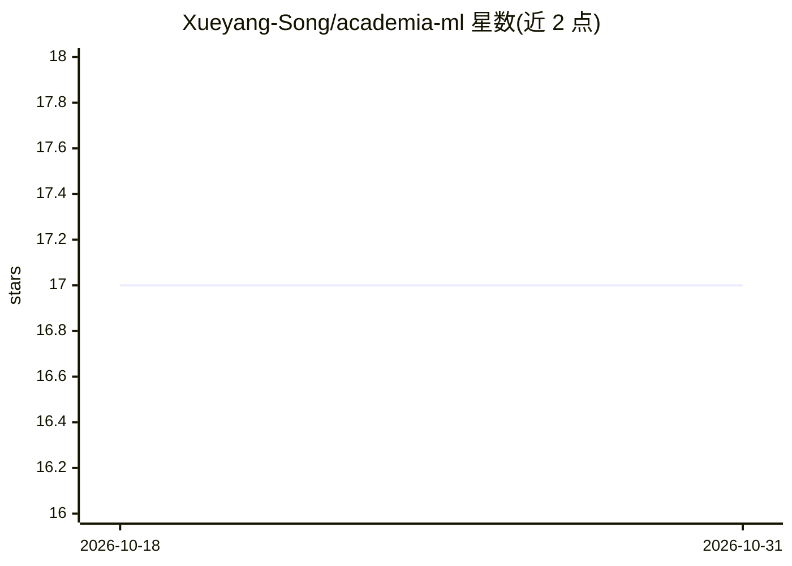

# Xueyang-Song/academia-ml

⭐ 17 · TypeScript · 推送 2026-05-12 · [GitHub](https://github.com/Xueyang-Song/academia-ml) · 个人维护

**面向科研人员的本地 AI 笔记本研究工作台**

Electron 桌面应用，为处理表格数据的科学家提供 notebook-first 研究工作台：原生 .ipynb 格式、通过 @jupyterlab/services 的本地 Jupyter 内核执行、Monaco 编辑器、每项目 Python 虚拟环境。AI 部分集成 GitHub Copilot SDK 与本地 Copilot CLI agent 队列，支持 OpenAI 兼容 provider，所有 AI 动作需显式批准；默认仅向 AI 提供表结构与摘要统计。CSV 解析自动推断列类型，遵循 data/raw → data/derived 管线约定。通过 git clone 源码安装。

## 筛选速览

| 维度 | 判定 | 备注 |
|---|---|---|
| AI 角色 | `ai-enhanced` | 去掉 AI 部分产品仍成立 |
| 许可风险 | `none` | — |
| 部署形态 | `None` |  |
| 模型依赖 | — | README 未给出锁定关系 |
| 硬件要求 | — | 无带数字的原话,不猜 |
| 安装摩擦 | `low` | 无编译、无系统依赖或容器化 |
| 成熟度 | — | 结构信号不足 |

## 能力要点

- 本地 Jupyter 内核执行原生 .ipynb 笔记本（Monaco 编辑器）
- AI Research Advisor 集成 GitHub Copilot SDK，支持 OpenAI 兼容 provider
- 所有 AI 动作需显式批准，默认仅暴露 schema 与摘要统计
- CSV 自动推断列类型与 data/raw → data/derived 管线约定

## 适用场景

- 在本地对表格数据跑机器学习工作流而不依赖云端
- 在笔记本中让 AI 顾问协助选择与解释 ML 工作流
- 数据敏感场景下的隐私保护研究分析

## 场景标签

`科研工具` `数据分析` · 领域:效率与自动化

## 证据(README 行号)

> L13: AcademiaML is a **notebook-first desktop research workbench** designed for scientists who have tabular data and nee
> L15: Think of it as **JupyterLab + RStudio + AI advisor**, packaged as a native desktop app:
> L33: ### 🤖 AI Research Advisor

## 星数曲线

2026-10-18 17 → 2026-10-31 17（+0）

---
*卡片 v1 · prompt 1.4 · 生成 2026-10-29 · 置信度 high · 依据 README sha `41d030aa1399` · [字段定义](../../DATASET.md)*
