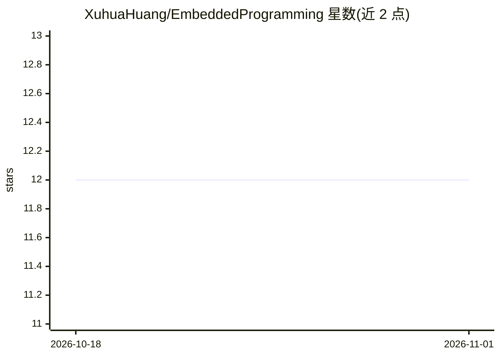

# XuhuaHuang/EmbeddedProgramming

⭐ 12 · C++ · MIT · 推送 2026-10-20 · [GitHub](https://github.com/XuhuaHuang/EmbeddedProgramming) · 个人维护

**个人现代 C++ 学习与实践代码集合：按主题分目录、CMake 构建**

个人维护的 C/C++ 编程实践仓库，按主题分目录组织，内容涵盖 STL、设计模式、Objective-C、HackerRank 与 LeetCode 解题、课程及个人项目（如终端进度条、OpenGL）。多数目录提供 CMakeLists.txt，用 CMake 构建并附带 GoogleTest 测试（ctest 运行）；也给出直接用 g++ 以 gnu++2b 标准编译单个文件的命令，以及 Windows 上用 MinGW/Ninja/Visual Studio 生成器的构建方式；依赖通过 vcpkg 获取。README 未展示机器学习代码的具体内容。

## 筛选速览

| 维度 | 判定 | 备注 |
|---|---|---|
| AI 角色 | `ai-knowledge` | 知识聚合/清单类 |
| 许可风险 | `permissive` | MIT |
| 部署形态 | `desktop` | 安装包/桌面程序 |
| 模型依赖 | — | README 未给出锁定关系 |
| 硬件要求 | — | 无带数字的原话,不猜 |
| 安装摩擦 | `medium` | 含编译或系统依赖之一 |
| 成熟度 | — | 结构信号不足 |

## 能力要点

- 按主题分目录组织的现代 C++ 实践代码集合
- 多数目录提供 CMakeLists.txt，支持 Ninja/MinGW/Visual Studio 生成器
- 附 GoogleTest 测试并用 ctest 运行
- 源文件内直接标注 g++ 编译命令（gnu++2b 标准）

## 适用场景

- 参考现代 C++ 各主题的示例代码与写法
- 学习 CMake 构建配置与 GoogleTest 测试组织
- 浏览常见算法题解与课程项目实现

## 场景标签

 · 领域:编程学习/软件工程

## 证据(README 行号)

> L16: This repository _hopefully_ can lead you through the **modern C++** world, with some of its popular tool chains.
> L18: **Most** of the directories are provided with a `CMakeLists.txt`.

## 星数曲线

2026-10-18 12 → 2026-11-01 12（+0）

---
*卡片 v1 · prompt 1.4 · 生成 2026-11-01 · 置信度 low · 依据 README sha `889479cbf550` · [字段定义](../../DATASET.md)*
