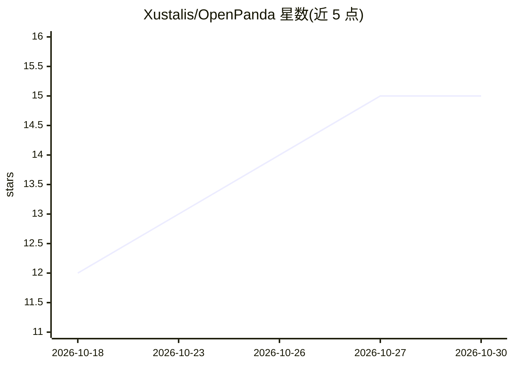

# Xustalis/OpenPanda

⭐ — · [GitHub]() · 个人维护 · 中文 README

**本地优先的多智能体编排器：跨设备调度终端 AI 编码代理**

自托管的多智能体编排系统：内置十个终端 AI 编码代理适配器（Claude Code、OpenAI Codex、Grok Build、DeepSeek Harness 等）加通用桥接，负责意图分类、任务分解、分发、执行监督与结果校验，自身不是代理。通过 P2P mesh 将任务路由到局域网内异构设备，支持 Ed25519 节点身份、分级信任、多跳中继与基于能力的调度。以单一静态 Go 二进制分发（约 20MB RSS），提供 TUI、Web 控制台与 CLI。语音输入、RPC 等功能标注为 experimental。

## 筛选速览

| 维度 | 判定 | 备注 |
|---|---|---|
| AI 角色 | `ai-ecosystem` | LLM/agent 周边工具 |
| 许可风险 | `none` | — |
| 部署形态 | `None` |  |
| 模型依赖 | locked-api |  |
| 硬件要求 | — | 无带数字的原话,不猜 |
| 安装摩擦 | `low` | 无编译、无系统依赖或容器化 |
| 成熟度 | `idea` | |

## 能力要点

- 十个内置代理适配器加通用桥接，统一分发与监督执行
- P2P mesh 跨设备任务路由，会话级 AEAD 加密与信任分级
- 多模型注册与健康熔断的透明故障转移
- MCP stdio 与 NDJSON RPC 嵌入面，供外部工具驱动

## 适用场景

- 把多台设备上的终端 AI 编码代理组成一个执行班组统一指挥
- 在局域网内把任务委派到最匹配硬件的节点执行
- 通过 TUI/Web 控制台/CLI 脚本编排多阶段多设备流水线

## 场景标签

`多智能体` `编码 Agent` · 领域:Agent 开发

## 证据(README 行号)

> L17: OpenPanda organizes the terminal AI coding agents already on your machines — ten bundled adapters (Claude Code, Ope
> L39: - **Multi-model registry & transparent failover** — `panda model add|switch|test` manages several providers per nod

## 星数曲线

2026-10-18 12 → 2026-10-30 15（+3）

---
*卡片 v1 · prompt 1.4 · 生成 2026-10-30 · 置信度 high · 依据 README sha `9df348a7d49f` · [字段定义](../../DATASET.md)*
