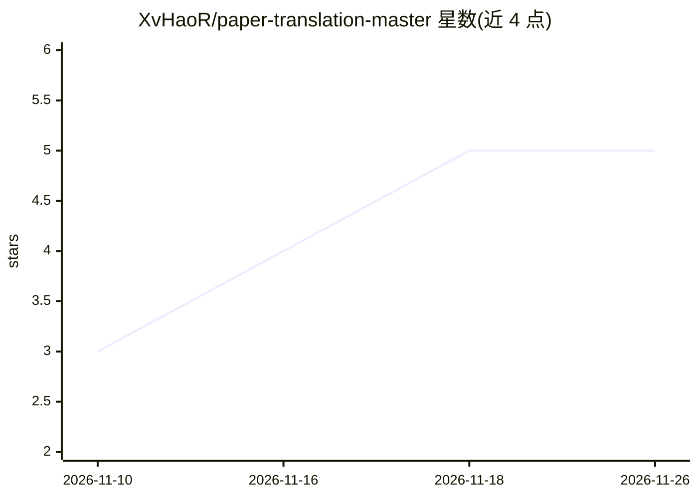

# XvHaoR/paper-translation-master

⭐ 5 · Python · AGPL-3.0 · 推送 2026-11-17 · [GitHub](https://github.com/XvHaoR/paper-translation-master) · 个人维护 · 中文 README

**Zotero 论文阅读插件：OCR 识别与大模型翻译段落对照**

以 Zotero 插件形式提供的论文阅读与翻译工具：解析 PDF 并支持本地 PaddleOCR-VL、RapidOCR、云端飞桨 OCR 三种识别方案，用户可编辑识别结果，并按需通过 OpenAI 兼容接口调用大模型做逐段双语翻译。识别结果与译文作为 Zotero 附件保存，可离线打开。融合预览版 0.7.1 将三种方案合并到单个插件，完整发布包面向 Windows x64，提供 GPU/CPU 一键安装方案。

## 筛选速览

| 维度 | 判定 | 备注 |
|---|---|---|
| AI 角色 | `ai-native` | 本体是模型或模型工具 |
| 许可风险 | `viral` | AGPL-3.0 |
| 部署形态 | `library` | 以包/库形式分发 |
| 模型依赖 | — | README 未给出锁定关系 |
| 硬件要求 | `gpu-8g` | |
| 安装摩擦 | `medium` | 含编译或系统依赖之一 |
| 成熟度 | — | 结构信号不足 |

## 能力要点

- 三种识别方案可切换：直接解析 PDF、本地 OCR（PaddleOCR-VL/RapidOCR）、云端飞桨 OCR
- HTML 对照原文阅读，支持双向滚动、点击定位、高亮，导出 HTML/Markdown/Excel，公式可复制 LaTeX
- 翻译绑定识别快照，支持逐段双语或仅译文，批量任务后台运行
- Windows x64 完整包一键安装，识别与译文离线保存为 Zotero 附件

## 适用场景

- 在 Zotero 中对照原文阅读英文论文并生成段落对照译文
- 扫描版 PDF 的 OCR 识别结果编辑与整理
- 无外网或离线环境下回看已识别与翻译的论文

## 场景标签

`OCR` `文档解析` `科研工具` · 领域:知识与检索

## 证据(README 行号)

> L3: 在 Zotero 中识别 PDF、对照原文阅读、编辑识别结果，并按需使用大模型翻译。识别结果和译文保存为 Zotero 附件，可离线打开。
> L5: **0.7.1 融合预览版**将直接解析 PDF、本地 OCR 和云端 OCR 合到一个插件。可在设置中选择默认方案，或在单篇阅读器和批量窗口临时切换。
> L35: - 在「翻译服务」中填写 OpenAI 兼容接口、模型和 API Key。Temperature 留空使用模型默认值。

## 星数曲线

2026-11-10 3 → 2026-11-26 5（+2）

---
*卡片 v1 · prompt 1.4 · 生成 2026-11-21 · 置信度 high · 依据 README sha `600b8b504452` · [字段定义](../../DATASET.md)*
