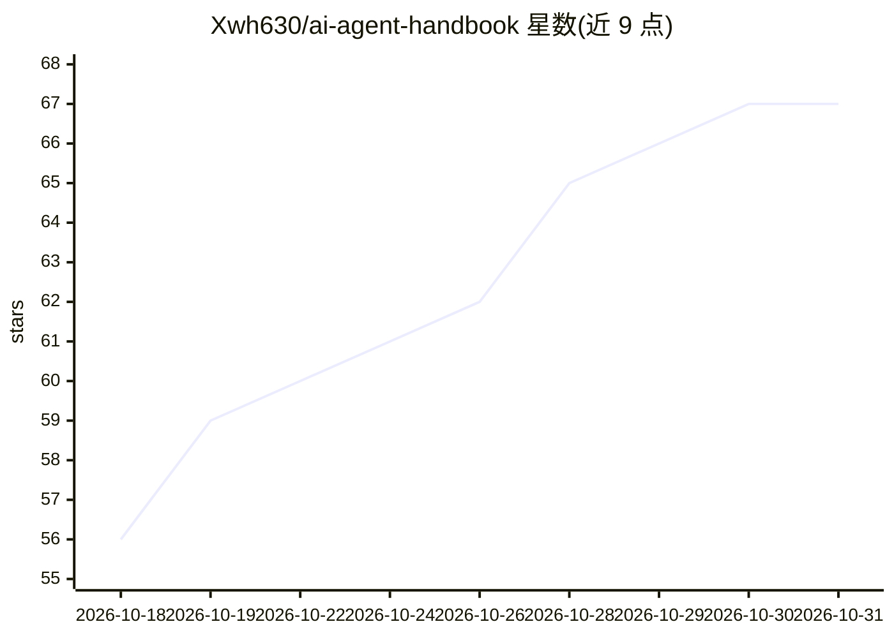

# Xwh630/ai-agent-handbook

⭐ 67 · Python · MIT · 推送 2026-10-30 · [GitHub](https://github.com/Xwh630/ai-agent-handbook) · [官网](https://xwh630.github.io/ai-agent-handbook/) · 个人维护 · 中文 README

**中文 AI Agent 系统学习手册：29 章教程+CLI 工具+Skill 包**

面向中文开发者的 AI Agent 学习手册，含 29+ 章教程、11 个可运行示例、115+ 中英术语对照，覆盖 LangGraph/CrewAI/AutoGen/Dify/Ollama 等 10+ 框架与 Codex CLI、Aider 等工具教程。除文档外提供可 pip 安装的 CLI（doctor 项目体检/全文检索/生成 Agent 骨架，零依赖离线可用）、可安装的 Agent Skill 包（SKILL.md 规范）、220 页 PDF 下载、Docker 一键环境及每周 Agent Radar 周刊。由在校学生课余维护，MIT 许可，Python 3.10+。

## 筛选速览

| 维度 | 判定 | 备注 |
|---|---|---|
| AI 角色 | `ai-knowledge` | 知识聚合/清单类 |
| 许可风险 | `permissive` | MIT |
| 部署形态 | `library` | 以包/库形式分发 |
| 模型依赖 | — | README 未给出锁定关系 |
| 硬件要求 | — | 无带数字的原话,不猜 |
| 安装摩擦 | `low` | 无编译、无系统依赖或容器化 |
| 成熟度 | — | 结构信号不足 |

## 能力要点

- 29 章教程 + 11 个可运行示例，覆盖 10+ 主流框架
- handbook CLI：doctor 项目体检、全文检索、生成 Agent 骨架
- 可安装 Skill 包（遵循 SKILL.md 规范）与零依赖 Skill 校验器
- 支持 DeepSeek、智谱、通义千问等国产模型 API

## 适用场景

- 零基础系统学习 AI Agent 开发，从手写 ReAct 到生产部署
- 用 handbook doctor 给现有 Agent 项目做工程体检
- 团队选型：按第 18 章决策树与框架对比总表选择框架
- 把手册 Skill 包装进 Claude 类客户端供 Agent 查阅

## 场景标签

`教程课程` · 领域:学习与行业

## 证据(README 行号)

> L7: **面向中文开发者的 AI Agent 系统学习指南** · 从零搭建到生产部署
> L9: 🚀 10 分钟零基础上手 · 10+ 框架全覆盖 · 29+ 章完整教程 · 11 个可运行示例 · 130+ 中英术语对照 · 可安装 Skill 包 · **可 pip 安装的 CLI**

## 星数曲线

2026-10-18 56 → 2026-10-31 67（+11）

---
*卡片 v1 · prompt 1.4 · 生成 2026-10-24 · 置信度 mid · 依据 README sha `f0c5b9546916` · [字段定义](../../DATASET.md)*
