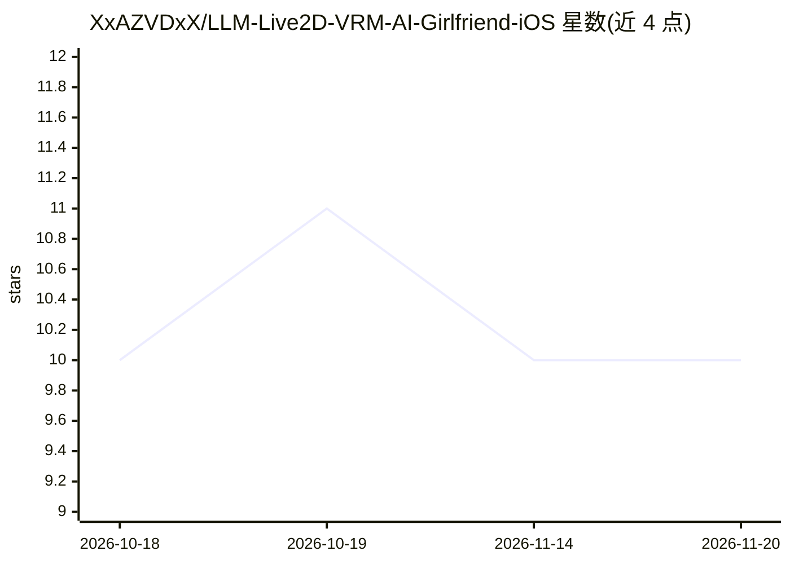

# XxAZVDxX/LLM-Live2D-VRM-AI-Girlfriend-iOS

⭐ 10 · 推送 2026-11-15 · [GitHub](https://github.com/XxAZVDxX/LLM-Live2D-VRM-AI-Girlfriend-iOS) · [官网](https://youtu.be/waKwxTZiP9w) · 个人维护 · 中文 README

**iPhone 上的 Live2D/VRM AI 伴侣应用：对话、语音、桌面小组件**

面向 iPhone 用户的 AI 伴侣应用，支持导入 Live2D 与 VRM/GLB 角色模型，角色可做表情、跟随头部动作，并提供好感度系统、聊天室自定义背景、画板、小组件、画中画、Apple Watch 等多表面入口。AI 后端可选 Azure OpenAI、ChatGPT、Grok、Google AI Studio、Apple Intelligence、LM Studio 局域网服务器或应用内下载的离线模型（Llama 3.2 1B/3B、DeepSeek-R1 蒸馏版）。安装方式为自行签名的未签名 IPA，需 iOS 26 以上，免费 Apple ID 签名后 7 天需重签，部分扩展功能可能受限。

## 筛选速览

| 维度 | 判定 | 备注 |
|---|---|---|
| AI 角色 | `ai-native` | 本体是模型或模型工具 |
| 许可风险 | `none` | — |
| 部署形态 | `desktop` | 安装包/桌面程序 |
| 模型依赖 | locked-api |  |
| 硬件要求 | — | 无带数字的原话,不猜 |
| 安装摩擦 | `low` | 无编译、无系统依赖或容器化 |
| 成熟度 | — | 结构信号不足 |

## 能力要点

- 支持 Live2D 与 VRM/GLB 角色模型，可导入自有模型
- 多种 AI 后端：云服务、Apple Intelligence、LM Studio 本地服务器、端侧离线模型
- 语音输入与自定义唤醒词、端侧 TTS 语音合成
- 画中画、主屏小组件、Apple Watch、自定义键盘等多表面集成

## 适用场景

- 在 iPhone 上与 Live2D/VRM 角色进行语音对话
- 不联网时用端侧离线模型聊天
- 通过局域网连接自己电脑上的 LM Studio 模型

## 场景标签

`聊天机器人` `语音合成` · 领域:对话与助手

## 证据(README 行号)

> L28: - Choose from several AI backends in Settings:
> L34: - **On-device offline models**: Llama 3.2 1B / 3B and DeepSeek-R1 distilled 1.5B / 7B — download them in the app an
> L107: The app is distributed as an **unsigned IPA**, so you need to sign it yourself before installing it on your iPhone

## 星数曲线

2026-10-18 10 → 2026-11-20 10（+0）

---
*卡片 v1 · prompt 1.4 · 生成 2026-11-20 · 置信度 high · 依据 README sha `3ebbc2f1ad3b` · [字段定义](../../DATASET.md)*
