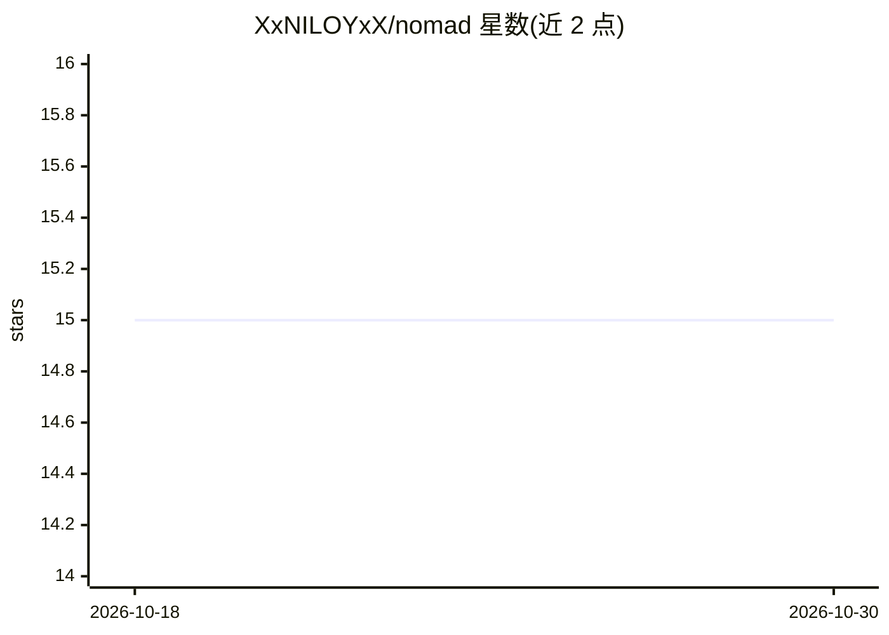

# XxNILOYxX/nomad

⭐ 15 · Python · GPL-3.0 · 推送 2026-04-19 · [GitHub](https://github.com/XxNILOYxX/nomad) · 个人维护

**核反应堆燃料装载模式优化工具：GA/PSO + ML 代理模型**

面向核工程研究的燃料组件富集度布局优化工具：以遗传算法、离散粒子群或 GA-PSO 混合算法搜索燃料装载方案，用 KNN、随机森林、Ridge、DNN 等机器学习模型作为 OpenMC 中子输运仿真加速代理，在达到目标 k_eff 的同时最小化功率峰因子（PPF）。最佳方案再经完整 OpenMC 仿真验证，结果回灌数据集迭代重训。要求用户自建符合特定结构的 OpenMC 模型（每个组件独立材料与栅元）并配置 config.ini，需安装 OpenMC。

## 筛选速览

| 维度 | 判定 | 备注 |
|---|---|---|
| AI 角色 | `ai-native` | 本体是模型或模型工具 |
| 许可风险 | `viral` | GPL-3.0 |
| 部署形态 | `library` | 以包/库形式分发 |
| 模型依赖 | — | README 未给出锁定关系 |
| 硬件要求 | — | 无带数字的原话,不猜 |
| 安装摩擦 | `low` | 无编译、无系统依赖或容器化 |
| 成熟度 | — | 结构信号不足 |

## 能力要点

- GA / Discrete PSO / Hybrid GA-PSO 三种优化算法
- DNN/KNN/Random Forest/Ridge/GBM 代理模型加速 OpenMC 中子输运仿真
- 验证仿真结果回灌数据集并重训代理模型的迭代改进机制
- 支持中心/外围分区富集度范围配置

## 适用场景

- 优化反应堆堆芯燃料装载模式以达到目标 k_eff 并降低 PPF
- 研究中对比不同 ML 代理模型对优化结果的影响
- 快堆（如 ABR-1000）富集度分区设计探索

## 场景标签

 · 领域:核工程/科学计算

## 证据(README 行号)

> L13: NOMAD is a sophisticated tool for optimizing nuclear reactor core fuel loading patterns. It leverages a **Genetic A
> L15: By integrating ML models as high-speed surrogates for computationally expensive neutron transport simulations (e.g.
> L41:  * **$k_{eff}$ Interpolator**: A K-Nearest Neighbors (KNN) regressor predicts $k_{eff}$ for a given fuel pattern.

## 星数曲线

2026-10-18 15 → 2026-10-30 15（+0）

---
*卡片 v1 · prompt 1.4 · 生成 2026-10-30 · 置信度 mid · 依据 README sha `3edb3efab99d` · [字段定义](../../DATASET.md)*
