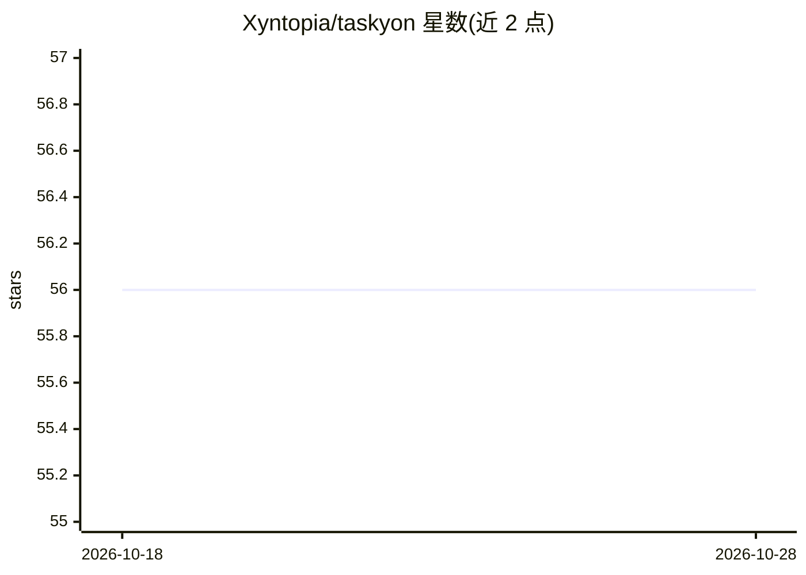

# Xyntopia/taskyon

⭐ 56 · TypeScript · MIT · 推送 2026-10-25 · [GitHub](https://github.com/Xyntopia/taskyon) · [官网](https://taskyon.space) · 组织维护

**本地优先的浏览器端 AI 聊天/任务树设计自动化工具**

开源的本地优先设计自动化系统：以聊天、工具调用与浏览器界面结合，将对话消息组织为可检视的任务树（问题、证据、决策、参数与输出）。支持工具执行、结构化浏览器研究编排（web 搜索、页面抓取、MCP 导入工具、代理回退）、沙盒化 JavaScript/Python 代码执行、文件上下文附件，以及 MathJax/Mermaid/SVG 等富文本渲染。模型接入兼容 OpenAI 格式的托管或自托管端点。目标是让成功的设计流程可检视、重放与分叉。面向工程师与研究者，通过 Yarn 4 monorepo（Quasar/Vue 3/Tauri）本地开发，亦提供托管版 taskyon.space。

## 筛选速览

| 维度 | 判定 | 备注 |
|---|---|---|
| AI 角色 | `ai-native` | 本体是模型或模型工具 |
| 许可风险 | `permissive` | MIT |
| 部署形态 | `None` |  |
| 模型依赖 | — | README 未给出锁定关系 |
| 硬件要求 | — | 无带数字的原话,不猜 |
| 安装摩擦 | `low` | 无编译、无系统依赖或容器化 |
| 成熟度 | — | 结构信号不足 |

## 能力要点

- 消息可成为任务树节点，保留结构化的来源、假设与参数记录
- 研究编排：web 搜索、页面抓取、MCP 浏览器工具与代理回退
- 沙盒化 JavaScript/Python 代码执行与文件上下文附件
- 本地优先存储，兼容 OpenAI 格式的托管或自托管模型端点

## 适用场景

- 通过聊天与工具研究并解决一次工程设计问题，之后重放与参数化复用
- 本地运行并自主管理 AI 工作流数据
- 将成功流程转化为可分叉共享的可执行工作流

## 场景标签

`聊天机器人` `工作流自动化` · 领域:效率与自动化

## 证据(README 行号)

> L7: Taskyon is an open-source, local-first design automation system for AI-assisted research, tool use,
> L85: - **LLM provider flexibility**: use OpenAI-compatible, hosted, or self-hosted model endpoints.

## 星数曲线

2026-10-18 56 → 2026-10-28 56（+0）

---
*卡片 v1 · prompt 1.4 · 生成 2026-10-24 · 置信度 high · 依据 README sha `556e3bb2c84d` · [字段定义](../../DATASET.md)*
