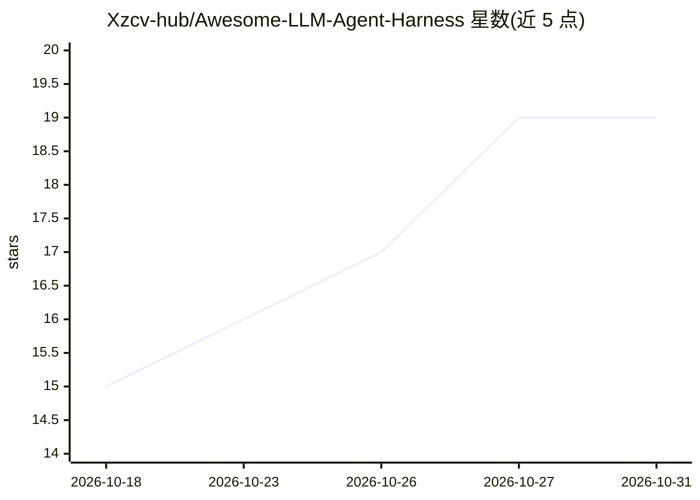

# Xzcv-hub/Awesome-LLM-Agent-Harness

⭐ 19 · MIT · 推送 2026-10-23 · [GitHub](https://github.com/Xzcv-hub/Awesome-LLM-Agent-Harness) · 个人维护

**LLM Agent Harness 论文与系统策展清单：人机交互/自进化/长程自主**

围绕 LLM agent harness（把语言模型变为 agent 的外部可执行层：控制流、工具、记忆、状态、验证、修复、安全与人类监督）收集论文、系统与基准资源。以'人机任务契约'组织内容，按人机交互、自进化 agent、长程 agent 行为三个主轴分类，配 Planning/Memory/Verification 等机制标签；每个条目按主要研究问题归入唯一位置。配套综述论文标注为即将发布，面向 agent 研究者与开发者。

## 筛选速览

| 维度 | 判定 | 备注 |
|---|---|---|
| AI 角色 | `ai-knowledge` | 知识聚合/清单类 |
| 许可风险 | `permissive` | MIT |
| 部署形态 | `None` |  |
| 模型依赖 | — | README 未给出锁定关系 |
| 硬件要求 | — | 无带数字的原话,不猜 |
| 安装摩擦 | `low` | 无编译、无系统依赖或容器化 |
| 成熟度 | — | 结构信号不足 |

## 能力要点

- 三轴分类：人机交互、自进化 Agent、长程 Agent 行为
- 机制标签体系（Planning/Orchestration/Tools/Memory 等 8 类）
- 以 Human-Machine Task Contract 为组织框架：人/LLM/工具环境/harness 的责任与控制分布
- 收录 harness 级自进化方向的 7 篇核心论文对比表

## 适用场景

- 查找 LLM agent harness 相关的综述、基准与系统论文
- 按人机交互/自进化/长程行为三个方向跟踪前沿研究
- 为 agent 系统设计参考验证、修复与安全机制的工作

## 场景标签

`精选清单` · 领域:学习与行业

## 证据(README 行号)

> L9: This repository collects papers, systems, benchmarks, and related resources on the **LLM agent harness**: the extern
> L15: The list is organized through the **Human-Machine Task Contract**: how responsibility, control, feedback, and adapt
> L35: **Mechanism tags:** `Planning` · `Orchestration` · `Tools` · `Memory` · `Verification` · `Safety` · `Learning` · `E

## 星数曲线

2026-10-18 15 → 2026-10-31 19（+4）

---
*卡片 v1 · prompt 1.4 · 生成 2026-10-28 · 置信度 high · 依据 README sha `53574d5f00f1` · [字段定义](../../DATASET.md)*
