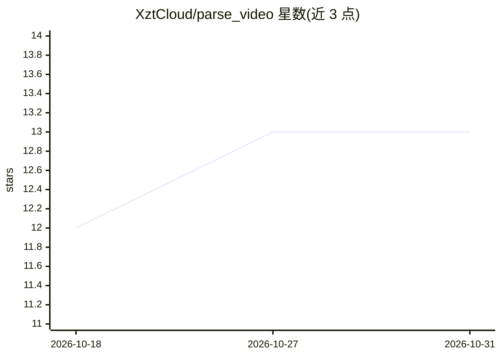

# XztCloud/parse_video

⭐ 13 · Python · MIT · 推送 2026-09-20 · [GitHub](https://github.com/XztCloud/parse_video) · 个人维护 · 中文 README

**短视频解析与 AI 剧本复刻的一键成片 Web 应用**

面向内容创作者的自部署 Web 应用：上传短视频或粘贴抖音链接，解析出带说话人台词、镜头描述与景别的结构化分镜剧本；再输入新主题后由 LangGraph 流水线重新生成剧情、多角色 TTS 配音、角色/场景图、分镜视频并合成成片。另支持小说转剧本与原片直转。技术栈为 Next.js + FastAPI + Celery + PostgreSQL，Docker Compose 6 服务一键部署；图像/视频生成可选本地 ComfyUI 或云端 RunningHub（Docker 部署固定云端）。README 列出多项已知限制（分镜视频仅处理第一个分镜、临时文件不自动清理等）。

## 筛选速览

| 维度 | 判定 | 备注 |
|---|---|---|
| AI 角色 | `ai-native` | 本体是模型或模型工具 |
| 许可风险 | `permissive` | MIT |
| 部署形态 | `self-host` | docker 或自建部署 |
| 模型依赖 | — | README 未给出锁定关系 |
| 硬件要求 | — | 无带数字的原话,不猜 |
| 安装摩擦 | `low` | 无编译、无系统依赖或容器化 |
| 成熟度 | — | 结构信号不足 |

## 能力要点

- 视频解析产出分镜表、JSON 剧情与镜头特征标签
- LangGraph 编排的复刻流水线：剧情→配音→图像→分镜视频→成片
- 云端 RunningHub / 本地 ComfyUI 两种生成方式
- 账号体系与资产隔离，管理员激活后才能生成

## 适用场景

- 解析爆款短视频结构，换主题批量复刻成片
- 把长篇小说章节转成分镜脚本并生成视频
- 自部署一套短视频解析与生成工作台

## 场景标签

`图像生成` `语音合成` `视频生成` · 领域:内容生成

## 证据(README 行号)

> L5: 上传一段短视频（或粘贴抖音分享链接），AI 解析出它的剧本结构；换一个主题，自动生成全新的剧情、配音、画面与成片。
> L24: 2. **复刻**：在解析结果之上输入一个新主题（比如“保留这个反转结构，把卖点从矿泉水换成猫粮”），系统就会沿着 LangGraph 编排的流水线重新生成剧情 → 配音 → 角色/场景图 → 分镜帧 → 分镜视频 → 合成成片，
> L71: |AI 编排|LangGraph（StateGraph）· LangChain|复刻流水线的多步骤工作流编排|

## 星数曲线

2026-10-18 12 → 2026-10-31 13（+1）

---
*卡片 v1 · prompt 1.4 · 生成 2026-10-31 · 置信度 high · 依据 README sha `6cb10c5d46ea` · [字段定义](../../DATASET.md)*
