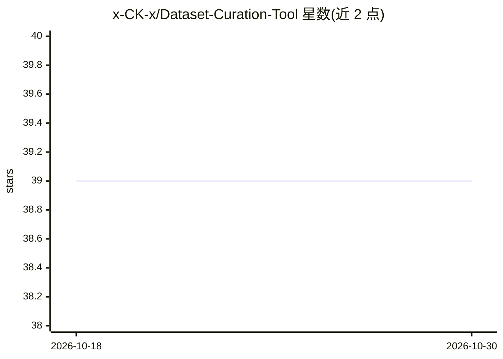

# x-CK-x/Dataset-Curation-Tool

⭐ 39 · Python · GPL-3.0 · 推送 2026-07-12 · [GitHub](https://github.com/x-CK-x/Dataset-Curation-Tool) · 个人维护

**本地优先的数据集整理与打标工具：管理媒体、运行模型、编排代理工作流**

面向本地媒体数据集管理的桌面/本地 Web 应用，覆盖数据集整理、图像/视频打标与字幕、模型下载加载与推理队列、3D 生成、媒体元数据、下载器与代理工具编排。AI 部分：Tag Editor / Graph / Code 等多个助手与编排器可规划并执行模型加载、推理、卸载任务，支持多模型 Quick Tag 队列、上下文自动压缩、可见推理轨迹覆盖层。模型下载支持 Hugging Face 快照与 ONNX 标签模型仓库，打标输出经 e621/Danbooru 等词典别名/蕴含规则归一化。文档存放于 docs/wiki/，README 以版本更新日志为主，安装步骤未在可见部分给出。

## 筛选速览

| 维度 | 判定 | 备注 |
|---|---|---|
| AI 角色 | `ai-native` | 本体是模型或模型工具 |
| 许可风险 | `viral` | GPL-3.0 |
| 部署形态 | `library` | 以包/库形式分发 |
| 模型依赖 | — | README 未给出锁定关系 |
| 硬件要求 | — | 无带数字的原话,不猜 |
| 安装摩擦 | `medium` | 含编译或系统依赖之一 |
| 成熟度 | — | 结构信号不足 |

## 能力要点

- 多模型 Quick Tag 推理队列（并行入队、逐任务进度/ETA）
- 助手/编排器可经审批的模型队列工具执行加载/推理/卸载
- Hugging Face 快照与小型 ONNX 标签仓库下载及生命周期跟踪
- 打标输出经词典别名解析与蕴含扩展归一化（e621/Danbooru 等）

## 适用场景

- 本地整理并批量为图像/视频数据集打标与评分
- 在 Tag Editor 中同时排队多个打标/评分模型并跟踪显存资源
- 通过代理图工作流编排模型调用、媒体探测与下载步骤

## 场景标签

`工作流自动化` `目标检测` · 领域:效率与自动化

## 证据(README 行号)

> L79: Adds a queued **Quick Tag** inference workflow in the Tag Editor. The quick-tag card now supports a multi-select mo
> L91: Tightens model-tag normalization for applied tags. Model-emitted tags/classes now continue through the selected tag
> L97: Fixes model-download progress so Hugging Face snapshot downloads, small ONNX tagger repos, and local payload finali

## 星数曲线

2026-10-18 39 → 2026-10-30 39（+0）

---
*卡片 v1 · prompt 1.4 · 生成 2026-10-25 · 置信度 low · 依据 README sha `07a0cf2fa8a6` · [字段定义](../../DATASET.md)*
