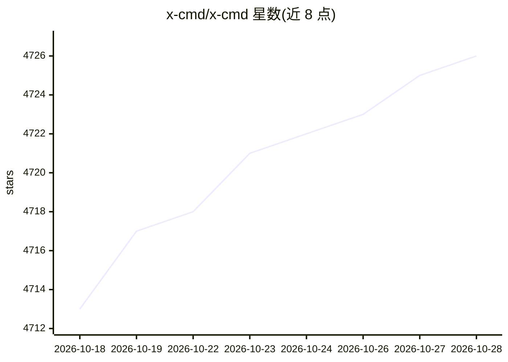

# x-cmd/x-cmd

⭐ 4,726 · Awk · Apache-2.0 · 推送 2026-10-24 · [GitHub](https://github.com/x-cmd/x-cmd) · [官网](https://x-cmd.com) · 组织维护 · 中文 README

**面向 AI agent 的 POSIX shell 增强工具箱与按需 CLI 包管理器**

面向 bash/zsh/ash/dash 等 POSIX shell 的工具箱：用 shell/awk 编写 300+ 功能模块（主题、补全、Git、AI 模块等），并提供 pkg 系统按需安装 600+ 个第三方 CLI 工具（jq、fzf、node 等），无需 root、不污染系统，可在 BusyBox/Alpine 等最小环境运行。AI 部分：通过 shell+curl 接入 OpenAI、Gemini、DeepSeek 等模型，并提供小于 2MB 的纯 shell agent；另为 OpenClaw、Claude Code 等 agent 提供接入提示词与 llms.txt 参考。核心约 1.1MB，curl 官方脚本一键安装。

## 筛选速览

| 维度 | 判定 | 备注 |
|---|---|---|
| AI 角色 | `ai-enhanced` | 去掉 AI 部分产品仍成立 |
| 许可风险 | `permissive` | Apache-2.0 |
| 部署形态 | `None` |  |
| 模型依赖 | locked-api |  |
| 硬件要求 | — | 无带数字的原话,不猜 |
| 安装摩擦 | `low` | 无编译、无系统依赖或容器化 |
| 成熟度 | — | 结构信号不足 |

## 能力要点

- 300+ shell/awk 功能模块，核心约 1.1MB，兼容 BusyBox/Alpine 最小环境
- pkg 系统按需安装 600+ CLI 工具，无需 root、无系统污染
- shell+curl 接入 OpenAI/Gemini/DeepSeek 等模型，含小于 2MB 的纯 shell agent
- 为 OpenClaw/Claude Code 等 agent 提供工具赋能提示词与 llms.txt 参考

## 适用场景

- 让 AI agent 掌握 1000+ 命令行工具的用法并直接调用
- 在最小容器或老旧系统上获得统一、可移植的 shell 工具集
- 按需临时安装 jq/fzf 等工具而不污染系统环境
- 在 shell 中调用多家 LLM 服务与轻量 agent

## 场景标签

 · 领域:开发者工具/Shell 基础设施

## 证据(README 行号)

> L15: X-CMD is a modern toolkit for POSIX shell (bash, zsh, ash, dash) — designed to make shell as powerful as Python's s
> L27: 4. **AI-Native Shell** — From ChatGPT era onward, we brought AI to shell. With just shell + curl, access OpenAI, Ge
> L29: 5. **Optimized for Agents** — After 5 years, we discovered shell's sweet spot: AI agents. Where network latency and

## 星数曲线

2026-10-18 4,713 → 2026-10-28 4,726（+13）

---
*卡片 v1 · prompt 1.4 · 生成 2026-10-20 · 置信度 high · 依据 README sha `42e68c58153c` · [字段定义](../../DATASET.md)*
