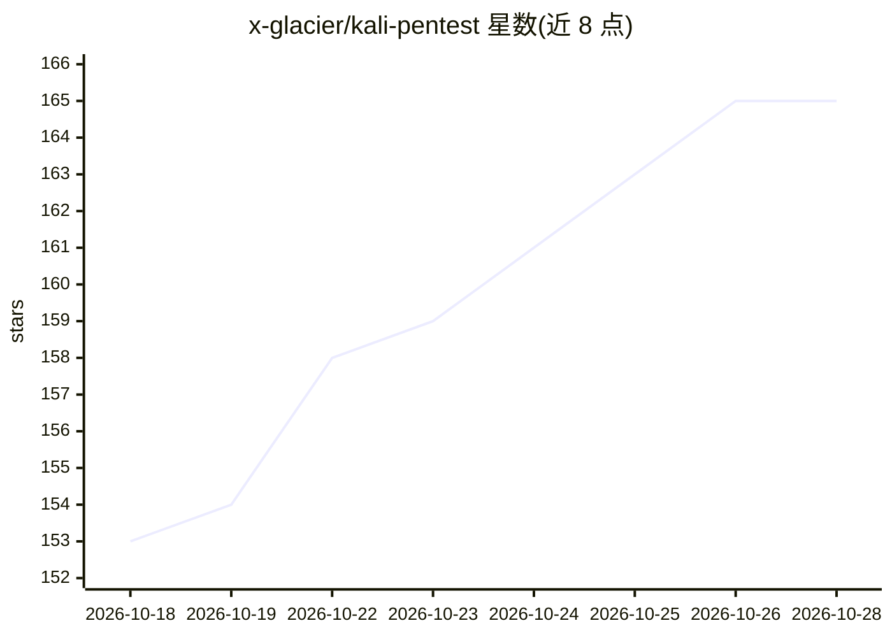

# x-glacier/kali-pentest

⭐ 165 · Apache-2.0 · 推送 2026-06-25 · [GitHub](https://github.com/x-glacier/kali-pentest) · 个人维护 · 中文 README

**面向 AI agent 的 Kali Linux 渗透测试技能包（269 工具/16 剧本）**

供 Claude Code、OpenClaw、Hermes Agent 等 AI agent 加载的渗透测试技能包：内置 269 个 CLI 工具的参考文档（按 14 类组织）与 16 个场景 playbook，覆盖内网、Web、API、AD、无线、云原生、移动、源码审计等场景。Agent 通过 SSH、Docker 或本地模式连接 Kali 环境，自主规划攻击路径、选择工具并生成报告；高风险操作设人工审批门，工具选择限定可 CLI 自动化者。以复制技能目录方式安装，含中文镜像目录。

## 筛选速览

| 维度 | 判定 | 备注 |
|---|---|---|
| AI 角色 | `ai-knowledge` | 知识聚合/清单类 |
| 许可风险 | `permissive` | Apache-2.0 |
| 部署形态 | `library` | 以包/库形式分发 |
| 模型依赖 | locked-api |  |
| 硬件要求 | — | 无带数字的原话,不猜 |
| 安装摩擦 | `low` | 无编译、无系统依赖或容器化 |
| 成熟度 | — | 结构信号不足 |

## 能力要点

- 269 个 CLI 工具参考文档，按 14 类组织，排除纯 GUI 工具
- 16 个场景 playbook，含决策树、风险门与客观停止条件
- Local/SSH Server/Docker 三种 Kali 环境接入模式
- 每条发现须附可复现命令及实际输出作为证据

## 适用场景

- 让 AI agent 在授权范围内自主执行渗透测试并生成报告
- 为安全团队提供结构化的多场景测试方法论
- 在隔离环境用本地模型运行渗透测试技能

## 场景标签

`网络安全` · 领域:学习与行业

## 证据(README 行号)

> L5: A penetration testing skill built on Kali Linux for AI agents such as Claude Code, OpenClaw, and Hermes Agent. Curre
> L229: The skill uses a four-layer document hierarchy. Each layer has a distinct responsibility, and the agent reads top-
> L236: |Tool reference|`<category>/tools/<name>.md`|Parameters, command examples, installation, notes, official links|

## 星数曲线

2026-10-18 153 → 2026-10-28 165（+12）

---
*卡片 v1 · prompt 1.4 · 生成 2026-10-22 · 置信度 mid · 依据 README sha `df94f85483b7` · [字段定义](../../DATASET.md)*
