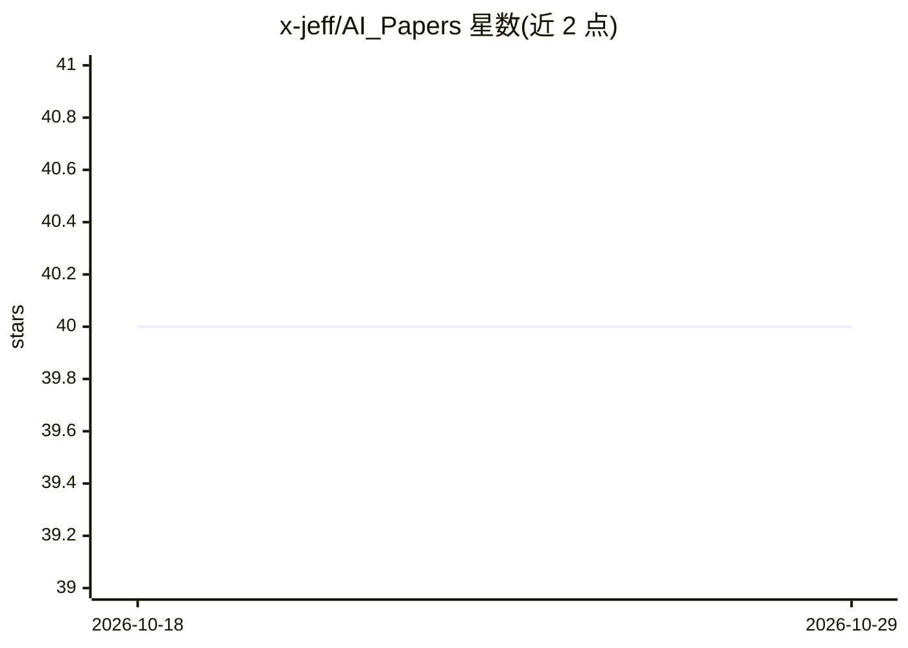

# x-jeff/AI_Papers

⭐ 40 · 推送 2026-09-11 · [GitHub](https://github.com/x-jeff/AI_Papers) · 个人维护 · 中文 README

**AI 经典论文中英链接清单（104 篇）配博客讲解**

以表格形式收录 104 篇人工智能领域论文，每条包含序号、论文题目、关键字、原文链接与博客讲解链接，覆盖 CNN 架构（LeNet5/ResNet/EfficientNet）、目标检测（R-CNN 系列/YOLO 系列）、分割（U-Net/Mask R-CNN）、人体姿态估计、GPT 与 BERT、Transformer 等方向。仓库为纯阅读资源，不含代码或安装步骤，供读者按主题查找论文原文与配套中文博客讲解。

## 筛选速览

| 维度 | 判定 | 备注 |
|---|---|---|
| AI 角色 | `ai-knowledge` | 知识聚合/清单类 |
| 许可风险 | `none` | — |
| 部署形态 | `None` |  |
| 模型依赖 | — | README 未给出锁定关系 |
| 硬件要求 | — | 无带数字的原话,不猜 |
| 安装摩擦 | `low` | 无编译、无系统依赖或容器化 |
| 成熟度 | — | 结构信号不足 |

## 能力要点

- 104 篇论文按表格组织，含原文与博客讲解双链接
- 覆盖 CNN 架构、目标检测、分割、姿态估计、NLP 等方向
- 每条目附关键字便于检索（如 YOLOv4、ViT、Focal Loss）

## 适用场景

- 按关键字查找某篇经典论文的原文与讲解
- 系统浏览 CV 与 NLP 领域代表性论文清单
- 结合博客讲解理解论文内容

## 场景标签

`精选清单` · 领域:学习与行业

## 证据(README 行号)

> L3: |序号|论文题目|关键字|原文|博客讲解|
> L5: |1|Gradient-Based Learning Applied to Document Recognition|LeNet5|🔗|🔗|

## 星数曲线

2026-10-18 40 → 2026-10-29 40（+0）

---
*卡片 v1 · prompt 1.4 · 生成 2026-10-25 · 置信度 high · 依据 README sha `0d62aa9b4d28` · [字段定义](../../DATASET.md)*
