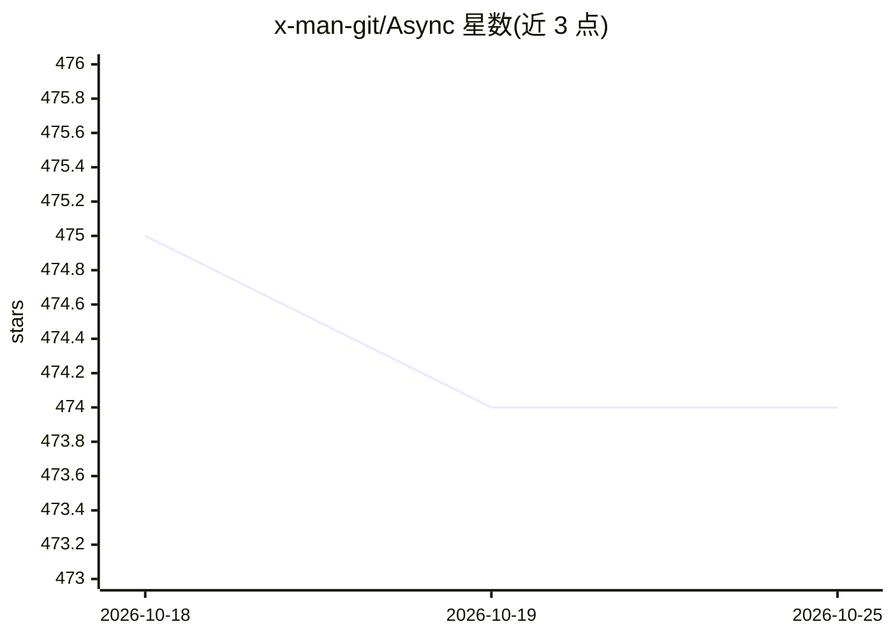

# x-man-git/Async

⭐ 474 · TypeScript · Apache-2.0 · 推送 2026-05-19 · [GitHub](https://github.com/x-man-git/Async) · 个人维护 · 中文 README

**给开发者的 agent 优先 AI 编码桌面工作台**

基于 Electron + React + Monaco 从零构建的 AI 编码桌面应用（非 VS Code fork），围绕 Think→Plan→Execute→Observe 循环组织 Agent、编辑器、Git 与终端。提供四种 Composer 模式、多 Agent Team 协作、Anthropic/OpenAI/Gemini 及 OpenAI 兼容端点（Ollama/vLLM/自托管）接入、BYOK 本地存储线程与配置，并支持 Telegram/Slack/Discord/飞书机器人桥接。安装需 Node.js>=18、npm>=9，通过 git clone 与 npm run desktop 从源码运行。

## 筛选速览

| 维度 | 判定 | 备注 |
|---|---|---|
| AI 角色 | `ai-native` | 本体是模型或模型工具 |
| 许可风险 | `permissive` | Apache-2.0 |
| 部署形态 | `library` | 以包/库形式分发 |
| 模型依赖 | local-ok | 支持本地模型 |
| 硬件要求 | — | 无带数字的原话,不猜 |
| 安装摩擦 | `low` | 无编译、无系统依赖或容器化 |
| 成熟度 | — | 结构信号不足 |

## 能力要点

- Agent/Plan/Ask/Debug 四种 Composer 模式与多 Agent Team 协作
- 多模型接入：Anthropic、OpenAI、Gemini 及 OpenAI 兼容端点（Ollama/vLLM/自托管）
- 内置浏览器自动化、LSP、MCP server 支持、文件索引与全功能终端
- Telegram/Slack/Discord/飞书 IM 机器人作为编码 agent 宿主

## 适用场景

- 在统一桌面环境中用 agent 编码、看 diff、跑终端
- 接入自托管或本地模型（BYOK）进行私密 AI 编码
- 通过 IM 机器人在聊天平台操控同一个 agent 工具链

## 场景标签

`编码 Agent` `多智能体` · 领域:Agent 开发

## 证据(README 行号)

> L21: The central idea is simple: **the agent is the center of gravity**, not a chat panel bolted onto the side of an edi
> L27: - **Agent-first loop** — Autonomous multi-round tool execution with streaming parameter cards (`Read`, `Write`, `Ed
> L30: - **Multi-model, multi-provider** — Anthropic, OpenAI, Gemini, plus any OpenAI-compatible endpoint (Ollama, vLLM, s

## 星数曲线

2026-10-18 475 → 2026-10-25 474（-1）

---
*卡片 v1 · prompt 1.4 · 生成 2026-10-23 · 置信度 high · 依据 README sha `5a5e681cccdd` · [字段定义](../../DATASET.md)*
