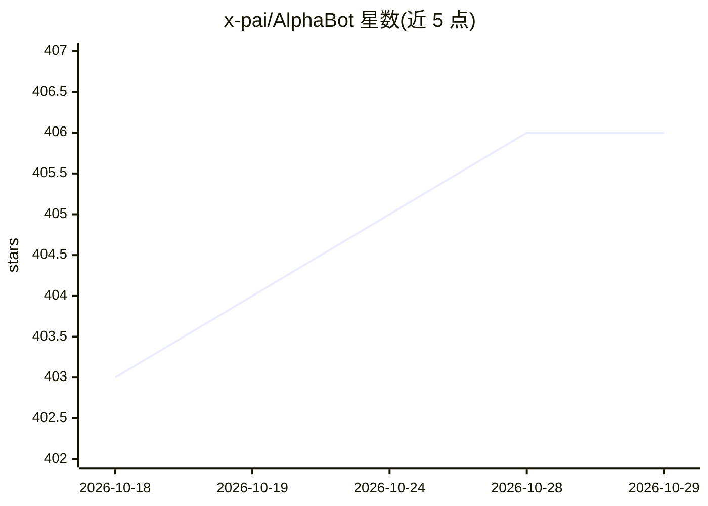

# x-pai/AlphaBot

⭐ 406 · Python · NOASSERTION · 推送 2026-10-26 · [GitHub](https://github.com/x-pai/AlphaBot) · [官网](https://alphabot.x-pai.com) · 组织维护 · 中文 README

**面向个人投资者的 AI 股票分析助手应用**

自托管的股票分析 Web 应用，前后端分离架构，提供基于大语言模型的 Agent 智能问答（联网搜索、自然语言生成走势图与分析报告、量化策略推荐）、机器学习市场预测、技术与基本面分析、风险评估等。数据源接入 Alpha Vantage（全球）、Tushare 与 AKShare（A股）。支持 Docker Compose 一键部署或手动安装（后端 pip/uvicorn，前端 npm），管理员可定时生成市场日报并推送。README 含大段免责声明，明示不构成收益保证。

## 筛选速览

| 维度 | 判定 | 备注 |
|---|---|---|
| AI 角色 | `ai-native` | 本体是模型或模型工具 |
| 许可风险 | `none` | NOASSERTION |
| 部署形态 | `self-host` | docker 或自建部署 |
| 模型依赖 | — | README 未给出锁定关系 |
| 硬件要求 | — | 无带数字的原话,不猜 |
| 安装摩擦 | `low` | 无编译、无系统依赖或容器化 |
| 成熟度 | — | 结构信号不足 |

## 能力要点

- LLM Agent 智能问答：联网搜索、自然语言生成图表与报告
- 机器学习模型预测与技术面/基本面分析
- 多数据源：Alpha Vantage、Tushare、AKShare（A股）
- Docker Compose 一键部署，管理员可定时生成市场日报

## 适用场景

- 自建一个股票数据分析与 AI 问答平台
- 获取 A 股与全球市场的行情、指标与风险评估
- 通过对话式 Agent 查询市场资讯并生成分析报告

## 场景标签

`金融量化` · 领域:学习与行业

## 证据(README 行号)

> L1: AlphaBot · 你的智能股票分析助手
> L43: - **智能问答**：基于大语言模型的智能金融顾问，随时解答您的投资疑问
> L58: - **机器学习预测**：使用训练好的模型进行市场预测

## 星数曲线

2026-10-18 403 → 2026-10-29 406（+3）

---
*卡片 v1 · prompt 1.4 · 生成 2026-10-22 · 置信度 mid · 依据 README sha `2352b08eac9d` · [字段定义](../../DATASET.md)*
