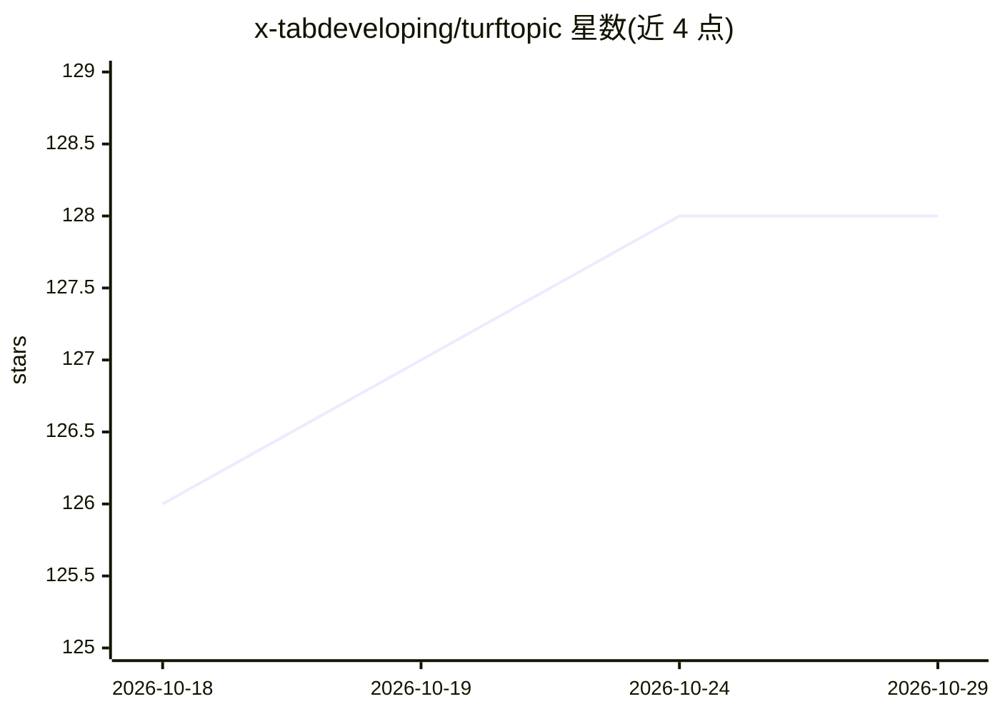

# x-tabdeveloping/turftopic

⭐ 128 · Python · MIT · 推送 2026-10-28 · [GitHub](https://github.com/x-tabdeveloping/turftopic) · [官网](https://x-tabdeveloping.github.io/turftopic/) · 组织维护

**基于 Transformer 表征的主题建模 Python 库，供文本分析者提取与解读主题**

Turftopic 是一个主题建模库，使用 sentence-transformers 产生的上下文表征训练多种主题模型（S³、KeyNMF、GMM、聚类模型 BERTopic/Top2Vec、FASTopic 等），支持动态、在线、种子、层级与多模态场景。模型遵循 scikit-learn API 约定，提供 pretty printing、可视化与 topicwizard 集成；可用 LLM 或 n-gram 检索自动命名主题。以 Python 包从 PyPI 安装，多个功能（Pyro、UMAP、OpenAI、spaCy）为可选依赖。

## 筛选速览

| 维度 | 判定 | 备注 |
|---|---|---|
| AI 角色 | `ai-native` | 本体是模型或模型工具 |
| 许可风险 | `permissive` | MIT |
| 部署形态 | `library` | 以包/库形式分发 |
| 模型依赖 | — | README 未给出锁定关系 |
| 硬件要求 | — | 无带数字的原话,不猜 |
| 安装摩擦 | `low` | 无编译、无系统依赖或容器化 |
| 成熟度 | — | 结构信号不足 |

## 能力要点

- 多种上下文主题模型实现（S³、KeyNMF、GMM、聚类与自编码类）
- 支持动态/在线/种子/层级/多模态主题建模
- LLM 或 n-gram 检索自动生成主题名称
- 遵循 scikit-learn API，集成 topicwizard 可视化

## 适用场景

- 对文档语料做主题建模并解读主题
- 追踪主题随时间的变化（动态主题建模）
- 用 LLM 为聚类出的主题自动命名与描述

## 场景标签

 · 领域:自然语言处理/文本挖掘

## 证据(README 行号)

> L1: Topic modeling is your turf too. Contextual topic models with representations from transformers.
> L8: |SOTA Transformer-based Topic Models|:compass: S³, :key: KeyNMF, :gem: GMM, 🗻 Topeax, 🌀 SensTopic, Clustering Models

## 星数曲线

2026-10-18 126 → 2026-10-29 128（+2）

---
*卡片 v1 · prompt 1.4 · 生成 2026-10-23 · 置信度 high · 依据 README sha `b2d910032f98` · [字段定义](../../DATASET.md)*
