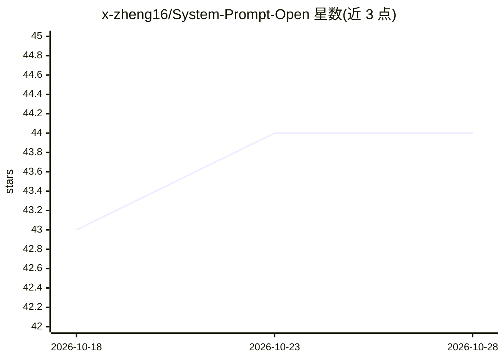

# x-zheng16/System-Prompt-Open

⭐ 44 · HTML · 推送 2026-04-04 · [GitHub](https://github.com/x-zheng16/System-Prompt-Open) · [官网](https://x-zheng16.github.io/System-Prompt-Open/) · 组织维护

**前沿 LLM 系统提示词提取结果开放数据库（45 条）**

发布 JustAsk 框架提取的 45 个前沿商业模型系统提示词，覆盖 Claude Code 的 4 个 agent、Gemini CLI 代码 agent 及 OpenAI、Anthropic、Google、Meta、DeepSeek、xAI 等 40 个商业 LLM。JustAsk 为自进化代码 agent，自主发现提取策略，对泄露的 Claude Code 源码验证准确率 85-95%。提供在线 Gallery 浏览、搜索与对比，配套 arXiv 论文（2601.21233），声明仅限学术安全研究与负责任披露，发布前做脱敏处理。

## 筛选速览

| 维度 | 判定 | 备注 |
|---|---|---|
| AI 角色 | `ai-knowledge` | 知识聚合/清单类 |
| 许可风险 | `none` | — |
| 部署形态 | `library` | 以包/库形式分发 |
| 模型依赖 | — | README 未给出锁定关系 |
| 硬件要求 | — | 无带数字的原话,不猜 |
| 安装摩擦 | `low` | 无编译、无系统依赖或容器化 |
| 成熟度 | — | 结构信号不足 |

## 能力要点

- 45 条前沿模型系统提示词提取结果
- 对 Claude Code 泄露源码的 85-95% 准确率验证（4 个 agent 分项）
- 在线 Live Gallery 支持搜索、筛选与对比
- 配套 JustAsk 提取框架与 arXiv 论文

## 适用场景

- 查找并对比各前沿模型的系统提示词内容
- 开展 LLM 安全与红队方向的学术研究
- 复用 JustAsk 框架自行提取其他 LLM 的系统提示词

## 场景标签

`网络安全` `科研工具` · 领域:学习与行业

## 证据(README 行号)

> L30: > System Prompt Open publishes the results: **45 extracted system prompts** from frontier models across all major p
> L55: 45 entries covering:

## 星数曲线

2026-10-18 43 → 2026-10-28 44（+1）

---
*卡片 v1 · prompt 1.4 · 生成 2026-10-25 · 置信度 mid · 依据 README sha `8ae3e74af9da` · [字段定义](../../DATASET.md)*
