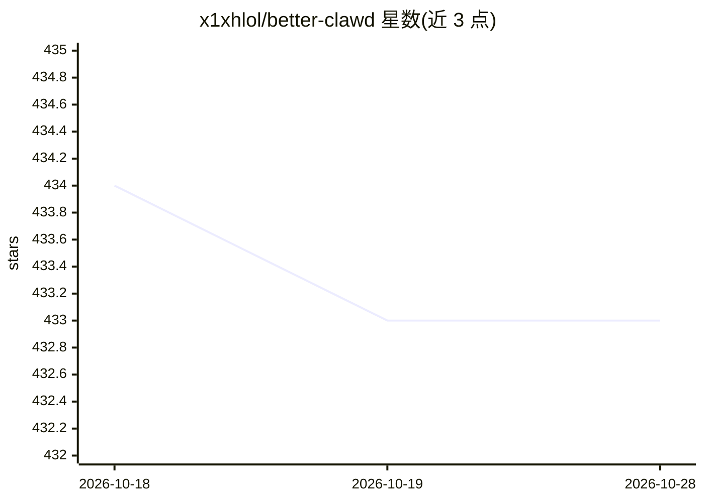

# x1xhlol/better-clawd

⭐ 433 · TypeScript · 推送 2026-07-01 · [GitHub](https://github.com/x1xhlol/better-clawd) · [官网](https://better-clawd.dev) · 个人维护

**Claude Code 的社区分支：多提供商接入、去遥测的编码 CLI**

Claude Code 的独立非官方 fork，保留原有 CLI 交互体验，移除遥测与上游服务依赖，支持 Anthropic、OpenAI（API key 与 Codex 登录导入/刷新）及 OpenRouter（API key、Anthropic 兼容与 Responses API 端点）多种提供商接入。登录与提供商切换通过 CLI 内 /login、/status 命令完成，环境变量适用于 CI、无头与自定义端点场景。以 npm 包形式分发，声明非官方、与 Anthropic 无隶属关系。

## 筛选速览

| 维度 | 判定 | 备注 |
|---|---|---|
| AI 角色 | `ai-native` | 本体是模型或模型工具 |
| 许可风险 | `none` | — |
| 部署形态 | `library` | 以包/库形式分发 |
| 模型依赖 | locked-api |  |
| 硬件要求 | — | 无带数字的原话,不猜 |
| 安装摩擦 | `low` | 无编译、无系统依赖或容器化 |
| 成熟度 | — | 结构信号不足 |

## 能力要点

- Anthropic / OpenAI / OpenRouter 多提供商支持，CLI 内 /login 与 /status 管理认证
- 移除遥测与 phone-home 行为，减少上游服务依赖
- 本地优先行为与自述的启动/空闲/长会话性能调优

## 适用场景

- 用同一个编码 CLI 在不同模型提供商之间切换
- 在不发送遥测数据的前提下使用 Claude Code 式工作流
- 在 CI 或无头环境中通过环境变量指定提供商运行

## 场景标签

`编码 Agent` · 领域:编码与开发

## 证据(README 行号)

> L3: > Claude Code, but better.
> L72: 1. Run `better-clawd`

## 星数曲线

2026-10-18 434 → 2026-10-28 433（-1）

---
*卡片 v1 · prompt 1.4 · 生成 2026-10-21 · 置信度 high · 依据 README sha `459de790e6dd` · [字段定义](../../DATASET.md)*
