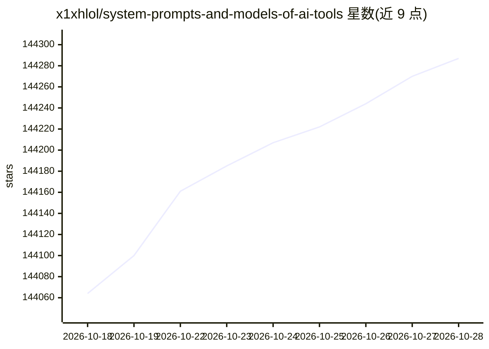

# x1xhlol/system-prompts-and-models-of-ai-tools

⭐ 144,287 · GPL-3.0 · 推送 2026-10-12 · [GitHub](https://github.com/x1xhlol/system-prompts-and-models-of-ai-tools) · 个人维护

**收录多款 AI 编程工具系统提示词的资料合集**

该仓库汇总多款 AI 工具（含 Cursor、Claude Code、Devin、Lovable、Windsurf、Perplexity、Replit、v0 等）的系统提示词及开源相关资料，以文件集合形式提供，无运行代码与安装流程。维护者通过 Discord 社区、Patreon、Ko-fi 与加密货币地址接收支持，并提供 ZeroLeaks 相关的安全提示内容。README 未给出目录结构或使用说明，仅包含社区与赞助信息。

## 筛选速览

| 维度 | 判定 | 备注 |
|---|---|---|
| AI 角色 | `ai-knowledge` | 知识聚合/清单类 |
| 许可风险 | `viral` | GPL-3.0 |
| 部署形态 | `None` |  |
| 模型依赖 | — | README 未给出锁定关系 |
| 硬件要求 | — | 无带数字的原话,不猜 |
| 安装摩擦 | `low` | 无编译、无系统依赖或容器化 |
| 成熟度 | — | 结构信号不足 |

## 动量与使用信号

- 维护:`active` — 距上次 push 5.7 天,年发版 0,31 位贡献者
- 涨星:近 1 天 **+13**(自 20261016 起算)

## 能力要点

- 收录 Augment Code、Claude Code、Cursor、Devin、Windsurf 等多款工具的系统提示词
- 附带 LeaksLab Discord 社区链接
- 提供 BTC/LTC/ETH、Patreon、Ko-fi 等赞助渠道
- 含面向 AI 创业公司的提示词安全提示

## 适用场景

- 查看某款 AI 编程工具的系统提示词内容
- 加入相关 Discord 社区获取更新

## 场景标签

`提示工程` `精选清单` · 领域:Agent 开发

## 证据(README 行号)

> L1: <a href="https://discord.gg/NwzrWErdMU" target="_blank">
> L12: > **Warning:** If you're an AI startup, make sure your data is secure. Exposed prompts or AI models can easily beco

## 星数曲线

2026-10-18 144,064 → 2026-10-28 144,287（+223）

---
*卡片 v1 · prompt 1.4 · 生成 2026-10-18 · 置信度 mid · 依据 README sha `95d1a0f2e437` · [字段定义](../../DATASET.md)*
