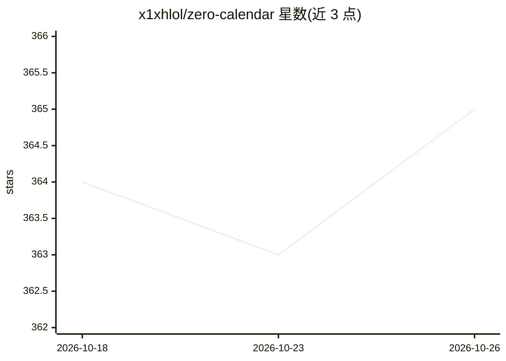

# x1xhlol/zero-calendar

⭐ 365 · TypeScript · MIT · 推送 2026-04-26 · [GitHub](https://github.com/x1xhlol/zero-calendar) · [官网](https://zerocalendar.com) · 个人维护

**开源自托管日历应用，用自然语言管理日程**

基于 Next.js 16、React 19、Convex、Better Auth 构建的日历 Web 应用：支持自然语言创建日程与日历操作、Google Calendar 同步与 webhook 更新、通过 Resend 发送邀请邮件、日历分析、冲突检测与空闲时间发现。AI 功能通过 OpenRouter AI SDK 接入（需配置 OPENROUTER_API_KEY）。部署路径为 Bun 安装依赖、本地运行 Convex 与 Next.js 开发服务器，或通过 Vercel 一键部署并配置 Convex、Google OAuth、Resend 等环境变量。MIT 许可。

## 筛选速览

| 维度 | 判定 | 备注 |
|---|---|---|
| AI 角色 | `ai-enhanced` | 去掉 AI 部分产品仍成立 |
| 许可风险 | `permissive` | MIT |
| 部署形态 | `None` |  |
| 模型依赖 | locked-api |  |
| 硬件要求 | — | 无带数字的原话,不猜 |
| 安装摩擦 | `low` | 无编译、无系统依赖或容器化 |
| 成熟度 | — | 结构信号不足 |

## 能力要点

- 自然语言日程创建与日历操作（OpenRouter AI SDK）
- Google Calendar 双向同步与 webhook 更新
- 邀请邮件（Resend）、冲突检测与空闲时间发现
- Better Auth + Convex 认证与用户数据存储

## 适用场景

- 自托管一个可控隐私的日历服务
- 用自然语言快速创建和管理日程
- 与 Google Calendar 同步并检测时间冲突

## 场景标签

 · 领域:日历/日程管理

## 证据(README 行号)

> L3: AI-powered scheduling with natural language event creation, Google Calendar sync, invite emails, and analytics built
> L9: - Natural-language scheduling and calendar actions

## 星数曲线

2026-10-18 364 → 2026-10-26 365（+1）

---
*卡片 v1 · prompt 1.4 · 生成 2026-10-21 · 置信度 high · 依据 README sha `79f3ce8f6f01` · [字段定义](../../DATASET.md)*
