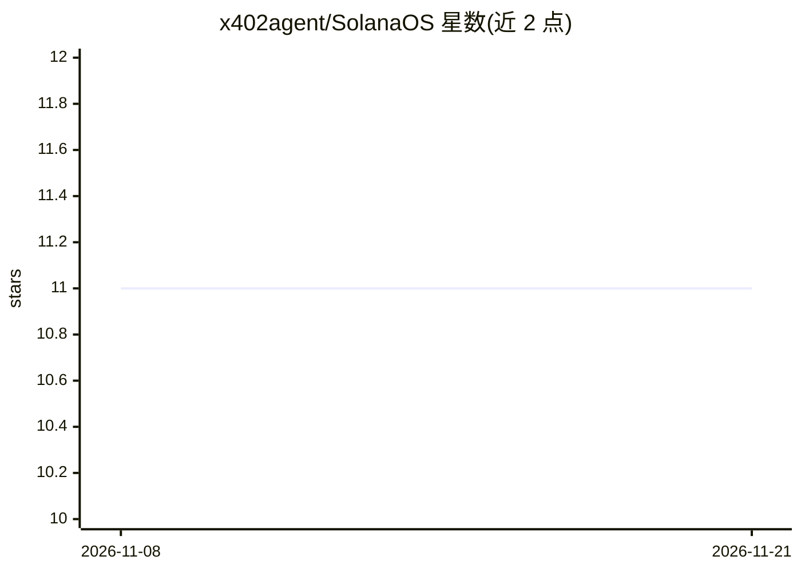

# x402agent/SolanaOS

⭐ 11 · JavaScript · MIT · 推送 2026-07-22 · [GitHub](https://github.com/x402agent/SolanaOS) · [官网](https://solanaos.net) · 组织维护

**面向交易者与开发者的 Solana 本地自治代理运行时**

以纯 Go 编写的本地优先 Solana 运行时，集成 OODA 交易循环、钱包连接、Telegram 控制、代理记忆（本地 vault 加 Honcho v3）与技能注册中心，支持 MCP 服务器接入 Claude Desktop/Cursor。单命令源码构建或 docker compose 启动网关、守护进程与 MCP 服务，也可一键部署到 Fly.io。含多模型聊天管线（AutoTune 采样参数自适应、EMA 反馈学习）与可选 Arduino 硬件层；要求配置 Helius RPC 与 LLM API key。

## 筛选速览

| 维度 | 判定 | 备注 |
|---|---|---|
| AI 角色 | `ai-native` | 本体是模型或模型工具 |
| 许可风险 | `permissive` | MIT |
| 部署形态 | `self-host` | docker 或自建部署 |
| 模型依赖 | local-ok | 支持本地模型 |
| 硬件要求 | — | 无带数字的原话,不猜 |
| 安装摩擦 | `low` | 无编译、无系统依赖或容器化 |
| 成熟度 | — | 结构信号不足 |

## 能力要点

- OODA 交易循环覆盖现货、swap 与永续（SolanaTracker/Jupiter/Hyperliquid/Aster）
- 两个 MCP 服务器，可接入 Claude Desktop 与 Cursor
- 源码、Make/npm、docker compose 与 Fly.io 多种启动部署路径
- AutoTune 上下文自适应采样与 EMA 用户反馈在线学习

## 适用场景

- 本地运行自主 Solana 交易与研究代理
- 通过 Telegram 或 Web 控制面板远程操作代理
- 把可复用代理技能发布到公共 Hub 注册中心
- 为代理生成独立钱包并通过 MCP 暴露

## 场景标签

`金融量化` · 领域:学习与行业

## 证据(README 行号)

> L18: Autonomous local-first runtime for Solana trading, research, wallets, automation, agent memory, Seeker/mobile contr
> L95: |`solanaos daemon`|—|Autonomous OODA agent loop, Telegram bot, memory|
> L147: - an OODA trading loop for spot, swaps, and perp workflows

## 星数曲线

2026-11-08 11 → 2026-11-21 11（+0）

---
*卡片 v1 · prompt 1.4 · 生成 2026-11-18 · 置信度 low · 依据 README sha `f6e0805deae1` · [字段定义](../../DATASET.md)*
