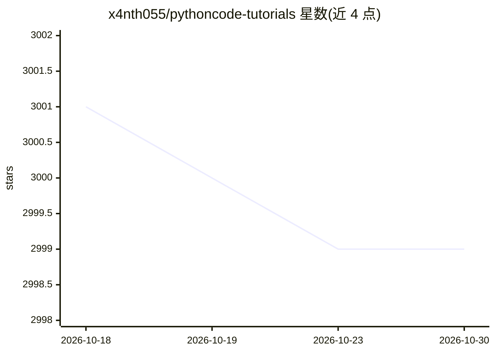

# x4nth055/pythoncode-tutorials

⭐ 2,999 · Jupyter Notebook · MIT · 推送 2026-09-30 · [GitHub](https://github.com/x4nth055/pythoncode-tutorials) · [官网](https://www.thepythoncode.com) · 个人维护

**The Python Code 网站的 Python 教程代码合集（多领域）**

聚合 The Python Code 网站全部教程的代码仓库，按主题组织：道德黑客/网络安全（Scapy、扫描器、密码破解等）、机器学习与 NLP（Transformers、BERT、文本生成）、计算机视觉（OpenCV、YOLO、Stable Diffusion）、通用 Python 与网页抓取，每条教程附代码链接。面向学习 Python 的开发者和学生，通过浏览目录跳转对应教程获取代码，仓库本身不提供安装运行方式。

## 筛选速览

| 维度 | 判定 | 备注 |
|---|---|---|
| AI 角色 | `ai-knowledge` | 知识聚合/清单类 |
| 许可风险 | `permissive` | MIT |
| 部署形态 | `None` |  |
| 模型依赖 | — | README 未给出锁定关系 |
| 硬件要求 | — | 无带数字的原话,不猜 |
| 安装摩擦 | `low` | 无编译、无系统依赖或容器化 |
| 成熟度 | — | 结构信号不足 |

## 能力要点

- 覆盖安全、ML/NLP、CV、爬虫等主题的教程代码索引
- 每条教程均附代码链接
- 含 BERT 微调、Stable Diffusion 图像生成、YOLO 检测等实践教程

## 适用场景

- 查找 Python 安全工具或 ML 项目的示例代码
- 跟随教程学习网络编程与计算机视觉
- 查找 RAG 聊天机器人、MCP 客户端/服务器等实现示例

## 场景标签

`教程课程` · 领域:学习与行业

## 证据(README 行号)

> L8: This is a repository of all the tutorials of The Python Code website.
> L9: ## List of Tutorials

## 星数曲线

2026-10-18 3,001 → 2026-10-30 2,999（-2）

---
*卡片 v1 · prompt 1.4 · 生成 2026-10-20 · 置信度 high · 依据 README sha `fed11eac5b3a` · [字段定义](../../DATASET.md)*
