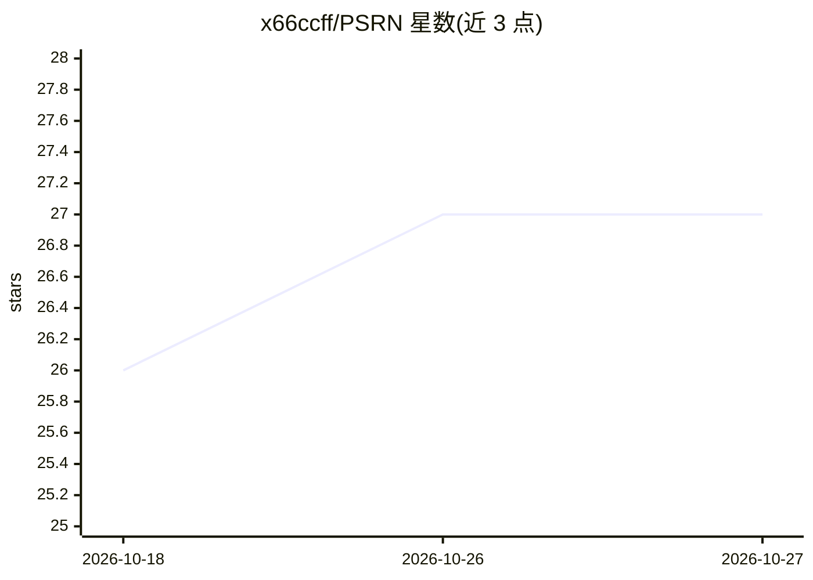

# x66ccff/PSRN

⭐ 27 · Python · MIT · 推送 2026-10-07 · [GitHub](https://github.com/x66ccff/PSRN) · 组织维护

**GPU 并行符号回归方法：从数据中快速发现符号表达式**

Nature Computational Science 论文的官方 PyTorch 实现，包含 PSE（并行符号枚举）方法与核心模块 PSRN（Parallel Symbolic Regression Network）。它在 GPU 上同时评估数百万个符号表达式，并通过自动子树复用加速搜索，用于从 CSV 数据中发现物理规律等符号表达式。提供 psrn-run 命令行工具，支持自定义数据、算子库、表达式探针与显存受限时的降配策略（减少输入槽位或改用 semi_koza/basic 算子集）。实验在 Nvidia A100 (80GB) 上进行，建议使用大显存 GPU。

## 筛选速览

| 维度 | 判定 | 备注 |
|---|---|---|
| AI 角色 | `ai-native` | 本体是模型或模型工具 |
| 许可风险 | `permissive` | MIT |
| 部署形态 | `library` | 以包/库形式分发 |
| 模型依赖 | — | README 未给出锁定关系 |
| 硬件要求 | — | 无带数字的原话,不猜 |
| 安装摩擦 | `medium` | 含编译或系统依赖之一 |
| 成熟度 | — | 结构信号不足 |

## 能力要点

- GPU 上同时评估数百万个符号表达式
- 自动子树复用机制
- psrn-run CLI 支持自定义 CSV 数据、算子库与表达式探针
- 提供低显存场景的算子集与层数调整方案

## 适用场景

- 从实验或仿真数据中发现物理规律的符号表达式
- 机器学习场景下做可解释的符号回归建模
- 对给定表达式做等价形式探针验证

## 场景标签

`科研工具` · 领域:学习与行业

## 证据(README 行号)

> L15: This repository contains the official PyTorch implementation of PSE (Parallel Symbolic Enumeration): A fast and eff
> L19: [2026/01/30] 🎉🎉🎉 Our paper has been selected as the cover article for Nature Computational Science, Volume 6, Issue

## 星数曲线

2026-10-18 26 → 2026-10-27 27（+1）

---
*卡片 v1 · prompt 1.4 · 生成 2026-10-26 · 置信度 high · 依据 README sha `6ea1599a5a1b` · [字段定义](../../DATASET.md)*
