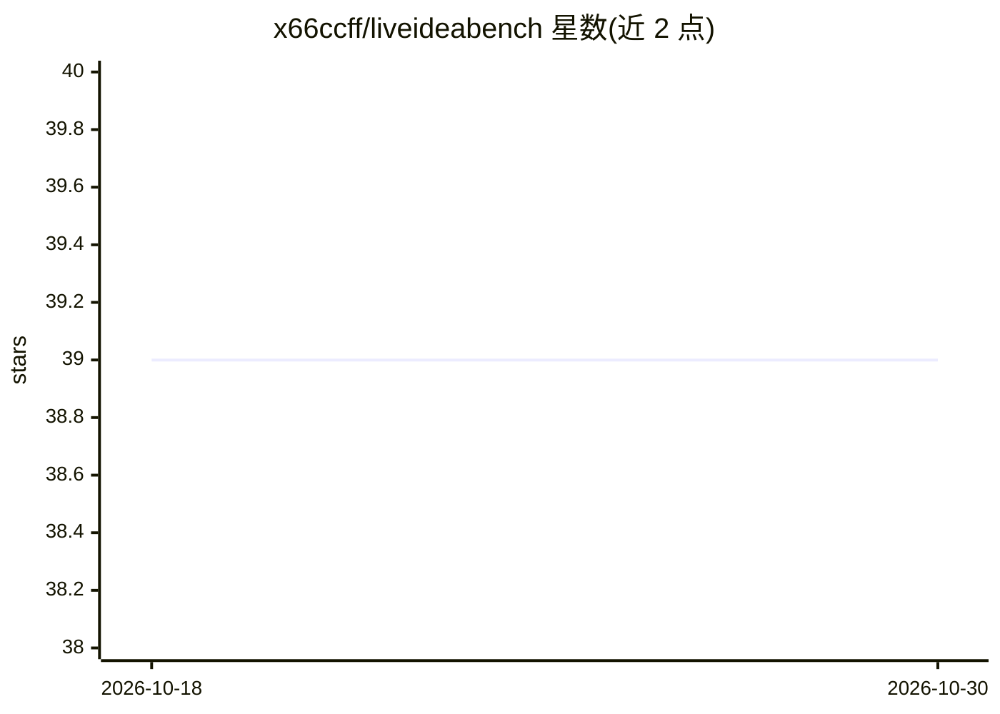

# x66ccff/liveideabench

⭐ 39 · Jupyter Notebook · MIT · 推送 2026-04-21 · [GitHub](https://github.com/x66ccff/liveideabench) · [官网](https://liveideabench.com/) · 组织维护

**评测 LLM 科学创造力与观点生成能力的基准框架**

LiveIdeaBench 是以极简上下文（关键词）评测 LLM 科学发散思维与观点生成的基准：通过 run.py 调用指定模型生成科学观点，经多维度评分（v2 新增 Clarity 维度与拒绝处理机制），并计算 Fluency、Flexibility、CO2 足迹等指标，支持数据库导出与分析。v2 覆盖 41 个模型（含 deepseek-r1、gemini-2.0-flash-thinking 等），数据集托管于 Hugging Face，附在线排行榜。论文已被 Nature Communications 接收。使用需配置至少一个 API key。

## 筛选速览

| 维度 | 判定 | 备注 |
|---|---|---|
| AI 角色 | `ai-ecosystem` | LLM/agent 周边工具 |
| 许可风险 | `permissive` | MIT |
| 部署形态 | `library` | 以包/库形式分发 |
| 模型依赖 | locked-api |  |
| 硬件要求 | — | 无带数字的原话,不猜 |
| 安装摩擦 | `low` | 无编译、无系统依赖或容器化 |
| 成熟度 | — | 结构信号不足 |

## 能力要点

- 关键词极简上下文驱动的科学观点生成与评分流水线
- v2 含 41 个模型结果，新增 Clarity 维度与拒绝处理机制
- Fluency/Flexibility 计算与可视化、CO2 排放估算
- 数据集托管 Hugging Face，附在线排行榜

## 适用场景

- 评测和比较不同 LLM 的科学创造力
- 复现论文中的基准实验与数据分析
- 查看 41 个模型的观点生成排行榜

## 场景标签

`模型评测` · 领域:评测与运维

## 证据(README 行号)

> L26: This v2 version of the benchmark incorporates the latest models, including: `claude-3.7-sonnet:thinking`, `o3-mini-
> L69: Generate and evaluate ideas using a specified model:
> L102: Fluency measures the diversity and uniqueness of the generated ideas. This script calculates the Fluency score bas

## 星数曲线

2026-10-18 39 → 2026-10-30 39（+0）

---
*卡片 v1 · prompt 1.4 · 生成 2026-10-25 · 置信度 high · 依据 README sha `18f374225d73` · [字段定义](../../DATASET.md)*
