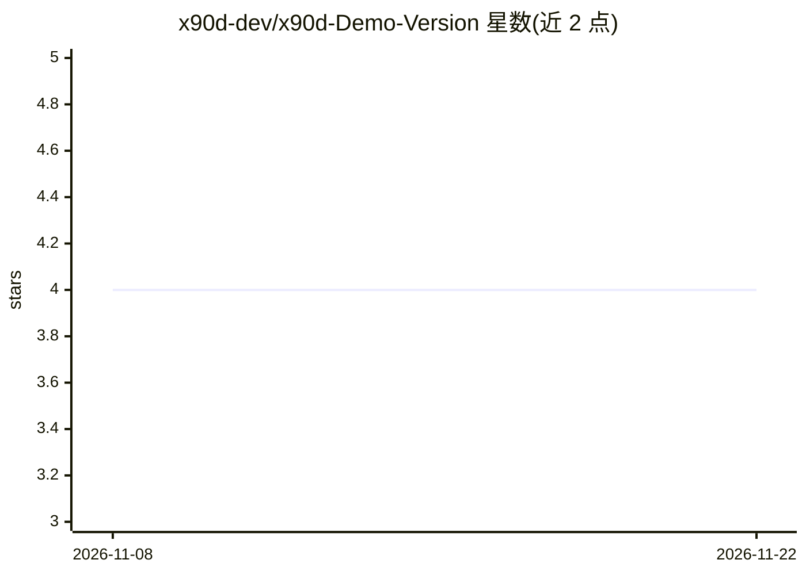

# x90d-dev/x90d-Demo-Version

⭐ 4 · Python · MIT · 推送 2026-11-04 · [GitHub](https://github.com/x90d-dev/x90d-Demo-Version) · [官网](agent) · 个人维护

**本地运行的自学 AI 助手：答疑、讲题、备考，数据不出本机**

面向学生的本地 Web/CLI 双界面 AI 辅导应用，基于 Flask + SQLite + Ollama 运行，默认模型 qwen2.5:3b，全部推理在本机完成，不调用付费商业 API。内置 Thinking Mode 结构化提示（分步推理、陷阱检测、防幻觉）、数学/物理/化学/编程/TOEFL 预设模式、PDF 与代码文件的文本抽取、可选 moondream 视觉分析、无 API 搜索兜底，以及管理员关键词规则注入。限制：默认上下文窗口 2048 token，PDF 解析仅支持数字文本型而非扫描件。

## 筛选速览

| 维度 | 判定 | 备注 |
|---|---|---|
| AI 角色 | `ai-native` | 本体是模型或模型工具 |
| 许可风险 | `permissive` | MIT |
| 部署形态 | `None` |  |
| 模型依赖 | local-ok | 支持本地模型 |
| 硬件要求 | — | 无带数字的原话,不猜 |
| 安装摩擦 | `low` | 无编译、无系统依赖或容器化 |
| 成熟度 | — | 结构信号不足 |

## 能力要点

- Ollama 本地推理，零付费 API，默认 qwen2.5:3b（可换 gemma2:2b / llama3.2:3b）
- Thinking Mode 提示层：分步推理、前提校验与防幻觉护栏
- PDF/代码/文本文件抽取与可选 moondream 本地视觉分析
- 管理员训练面板以关键词规则注入事实，无需微调模型

## 适用场景

- 在 8–12 GB RAM 的笔记本上离线做学科答疑与概念讲解
- 准备 TOEFL 结构与阅读练习
- 本地分析代码文件并进行调试
- 不希望对话数据发送到外部服务的场景

## 场景标签

`AI 助手` · 领域:对话与助手

## 证据(README 行号)

> L5:  **Private, Lightweight, and Local AI-Powered Learning Assistant**
> L25: **x90d** adalah aplikasi web asisten AI tutor mandiri yang didesain untuk berjalan sepenuhnya di lingkungan lokal (
> L35: * 🧠 **Thinking Mode & Guardrails:** Lapisan prompt terstruktur untuk memicu penalaran bertahap, deteksi jebakan soa

## 星数曲线

2026-11-08 4 → 2026-11-22 4（+0）

---
*卡片 v1 · prompt 1.4 · 生成 2026-11-21 · 置信度 high · 依据 README sha `a3b9255214c4` · [字段定义](../../DATASET.md)*
