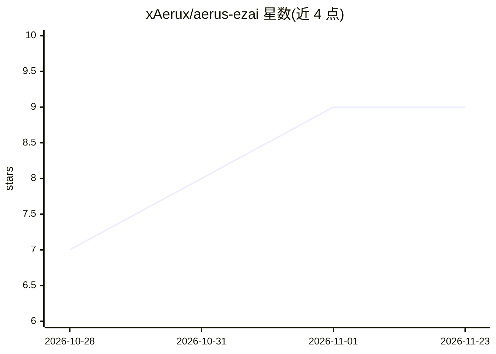

# xAerux/aerus-ezai

⭐ 9 · TypeScript · MIT · 推送 2026-10-25 · [GitHub](https://github.com/xAerux/aerus-ezai) · 个人维护

**Windows 本地 AI 工具管理面板：安装、启动与用量追踪**

面向 Windows 的桌面应用，整合 AI 工具的发现、安装与启动入口，并附带本地模型信息管理、AI 知识学习和开发指南模块。内置三个工具：Aerus AI Usage HUD 聚合 Codex、Claude Code、Ollama 的 token 用量并估算 API 等价成本；Aerus SDM 做系统启动项管理与诊断；Codex Crunch 与 Claude Crunch 提供配置指南与提示词。通过 exe 安装包分发，目前无代码签名证书，部分功能依赖已安装的外部 AI 软件与网络连接。

## 筛选速览

| 维度 | 判定 | 备注 |
|---|---|---|
| AI 角色 | `ai-ecosystem` | LLM/agent 周边工具 |
| 许可风险 | `permissive` | MIT |
| 部署形态 | `desktop` | 安装包/桌面程序 |
| 模型依赖 | local-ok | 支持本地模型 |
| 硬件要求 | — | 无带数字的原话,不猜 |
| 安装摩擦 | `low` | 无编译、无系统依赖或容器化 |
| 成熟度 | `idea` | |

## 能力要点

- 聚合 Codex / Claude Code / Ollama 的 token 用量仪表盘与会话历史
- AI 安装器模块提供受支持 AI 应用的安装与配置入口
- 附 SDM 系统启动项管理与诊断工具
- MIT 许可，安装包内含主程序、HUD 与 SDM

## 适用场景

- 集中发现、安装和启动各类本地 AI 应用
- 统计编码代理与本地模型的 token 消耗与估算成本
- 新手学习 AI 工具的安装、配置与开发工作流

## 场景标签

 · 领域:AI 工具管理/桌面工具

## 证据(README 行号)

> L16: Welcome to **AERUS AI EZ** — a Windows desktop application built to make discovering, installing, launching, and un
> L27: |🤖 **AI Installers**|Discover supported AI applications and access installation and setup options.|
> L41: The **Aerus AI Usage HUD** brings supported token usage information together in one standalone Windows dashboard.

## 星数曲线

2026-10-28 7 → 2026-11-23 9（+2）

---
*卡片 v1 · prompt 1.4 · 生成 2026-11-20 · 置信度 high · 依据 README sha `56b9adaffff2` · [字段定义](../../DATASET.md)*
