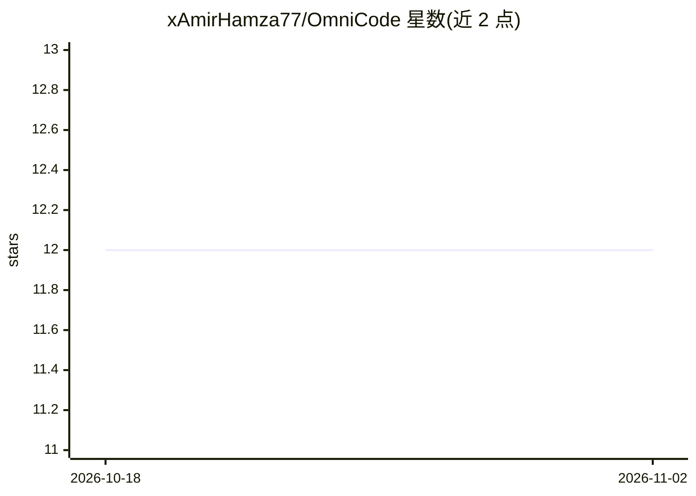

# xAmirHamza77/OmniCode

⭐ 12 · TypeScript · MIT · 推送 2026-10-20 · [GitHub](https://github.com/xAmirHamza77/OmniCode) · 个人维护

**集成 169+ AI 供应商接入与路由的 VS Code 系 AI IDE**

基于 VS Code 编辑器的桌面 IDE（TypeScript/Electron），内置 OmniProxy 控制中心：通过 OAuth 或 API Key 接入 169+ AI 供应商，将所有模型同步到编辑器原生选择器；支持多模型 Combo 回退链、语义缓存、成本看板、预算与配额控制、PII 防护及 AES-256-GCM 密钥加密存储，并兼容任意 OpenAI 兼容自定义端点。免费层供应商（Kiro、Qoder、Gemini CLI 等）用于 $0 路由。面向需要在一个编辑器内集中管理多 AI 供应商的开发者；MIT 许可，提供发布安装包。

## 筛选速览

| 维度 | 判定 | 备注 |
|---|---|---|
| AI 角色 | `ai-enhanced` | 去掉 AI 部分产品仍成立 |
| 许可风险 | `permissive` | MIT |
| 部署形态 | `desktop` | 安装包/桌面程序 |
| 模型依赖 | locked-api |  |
| 硬件要求 | — | 无带数字的原话,不猜 |
| 安装摩擦 | `low` | 无编译、无系统依赖或容器化 |
| 成熟度 | — | 结构信号不足 |

## 能力要点

- OAuth/API Key 接入 169+ AI 供应商，统一模型选择器
- 多模型 Combo 回退链与 5 种路由策略（优先级/轮询/成本优化等）
- 语义缓存、成本分析看板、配额与预算控制
- 内置 OmniProxy 管理面板：供应商管理、批量测试、缓存与用量分析

## 适用场景

- 在一个编辑器内使用并管理多家 AI 供应商的模型
- 订阅配额耗尽时自动回退到免费层模型继续编码
- 追踪按供应商/模型的 token 与费用支出
- 将任意 OpenAI 兼容端点接入编辑器统一调用

## 场景标签

`模型网关` · 领域:Agent 开发

## 证据(README 行号)

> L113: |🖥️ Full IDE experience|✅ VS Code-based editor|✅|❌ CLI only|
> L5:  The AI-Native IDE with a Built-In Provider Control Center. Connect 169+ AI providers. Route across free & paid mode

## 星数曲线

2026-10-18 12 → 2026-11-02 12（+0）

---
*卡片 v1 · prompt 1.4 · 生成 2026-10-31 · 置信度 low · 依据 README sha `dea5e606eeb1` · [字段定义](../../DATASET.md)*
