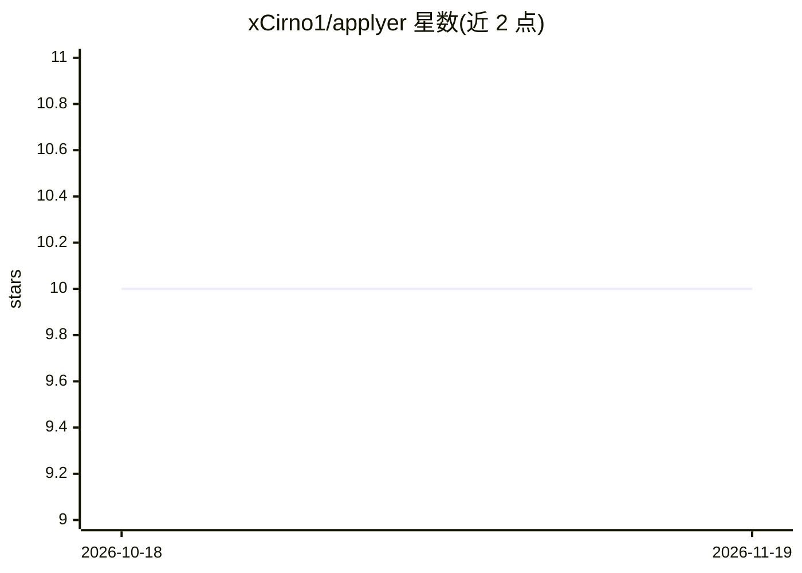

# xCirno1/applyer

⭐ 10 · TypeScript · MIT · 推送 2026-11-08 · [GitHub](https://github.com/xCirno1/applyer) · 个人维护

**把编码 agent 变成求职助手的本地桌面工作台**

Electron 桌面应用，将嵌入式终端与求职看板结合：连接 Claude Code、Codex 等 MCP 兼容 CLI，或接入 OpenRouter 使用内置 agent，由 agent 研究招聘网站、给职位打分、组织申请管线、填写表单，最终提交由用户完成。数据本地存储，支持 SQLite 加密与 OS 钥匙串保护密钥，MCP 工具面经过验证且不含提交动作，所有操作记录于活动日志。

## 筛选速览

| 维度 | 判定 | 备注 |
|---|---|---|
| AI 角色 | `ai-native` | 本体是模型或模型工具 |
| 许可风险 | `permissive` | MIT |
| 部署形态 | `desktop` | 安装包/桌面程序 |
| 模型依赖 | locked-api |  |
| 硬件要求 | — | 无带数字的原话,不猜 |
| 安装摩擦 | `low` | 无编译、无系统依赖或容器化 |
| 成熟度 | — | 结构信号不足 |

## 能力要点

- 连接 MCP 兼容 CLI（Claude Code/Codex）或 OpenRouter 内置 agent 双模式
- 跨 Indeed、LinkedIn、Seek 等站点及 Greenhouse/Lever/Ashby/Workday 公共职位板搜索
- MCP 工具面：表单检查、权限门控导航，无任何工具可执行最终提交
- 基于结构化主简历生成命名简历变体，支持 diff 审查与 PDF 渲染

## 适用场景

- 在一个本地工作台里搜索、比较、排队并起草职位申请
- 让 agent 重复性填表，自己把控每次最终提交
- 为不同职位维护多份简历变体并审查改动

## 场景标签

`浏览器自动化` `AI 写作` · 领域:效率与自动化

## 证据(README 行号)

> L24: Applyer pairs an embedded terminal with a live application board. Connect an
> L28: Applyer's built-in agent instead, describe the roles you want, and let the agent
> L62: - **Bounded automation.** The MCP bridge exposes a small, validated tool surface. Form

## 星数曲线

2026-10-18 10 → 2026-11-19 10（+0）

---
*卡片 v1 · prompt 1.4 · 生成 2026-11-19 · 置信度 high · 依据 README sha `c3ecd43c127f` · [字段定义](../../DATASET.md)*
