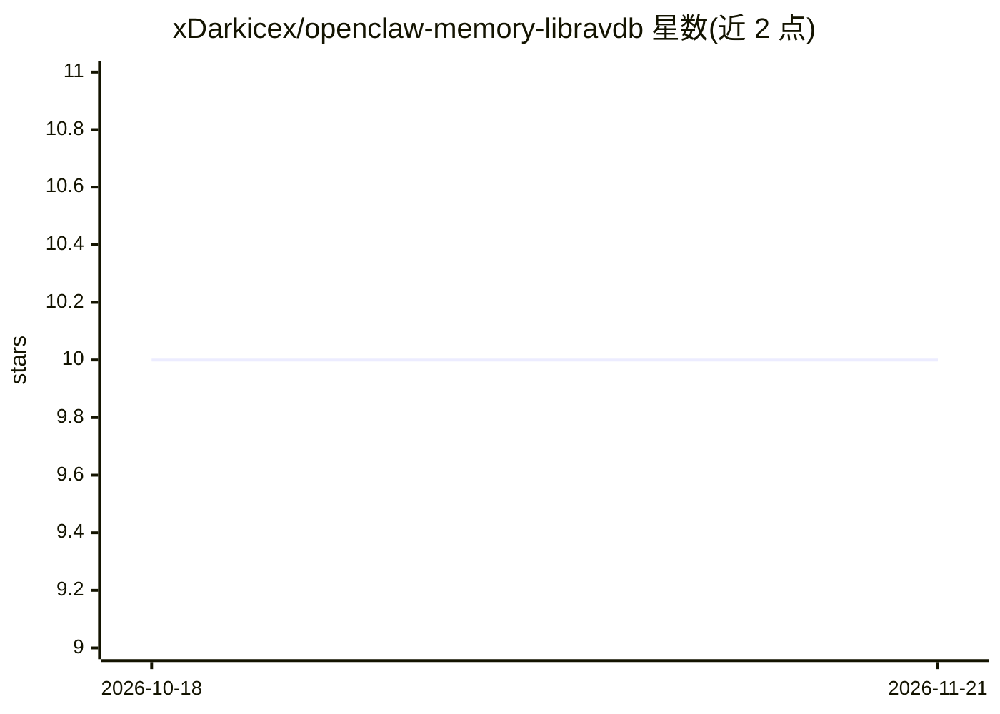

# xDarkicex/openclaw-memory-libravdb

⭐ 10 · TypeScript · 推送 2026-11-05 · [GitHub](https://github.com/xDarkicex/openclaw-memory-libravdb) · 个人维护

**为 OpenClaw 提供本地持久记忆内核与上下文生命周期管理**

以 Go 编写的本地记忆守护进程 libravdbd，配合 OpenClaw 插件安装后接管默认记忆系统：768 维向量检索、BM25+向量混合搜索、六层认知分类（身份/事实/偏好/约束/决策/情节）、会话自动压缩摘要、矛盾检测、用户身份卡与机器人 persona 注入。架构上 Agent 经 gRPC+mTLS 访问守护进程，支持本地 GGUF/ONNX 推理或远程后端，提供 Docker、Helm、Terraform 部署路径。需 OpenClaw >= 2026.3.22 与 Node.js >= 22。

## 筛选速览

| 维度 | 判定 | 备注 |
|---|---|---|
| AI 角色 | `ai-ecosystem` | LLM/agent 周边工具 |
| 许可风险 | `none` | — |
| 部署形态 | `self-host` | docker 或自建部署 |
| 模型依赖 | — | README 未给出锁定关系 |
| 硬件要求 | — | 无带数字的原话,不猜 |
| 安装摩擦 | `low` | 无编译、无系统依赖或容器化 |
| 成熟度 | — | 结构信号不足 |

## 能力要点

- BM25+向量混合检索与六类认知分类过滤
- 长会话自动压缩为可检索摘要，含摘要展开工具（memory_describe/expand/grep）
- 用户身份卡与 bot persona 以 user card 形式存储并注入会话
- 本地 GGUF/ONNX 推理后端，支持 Apple Silicon 与 NVIDIA 硬件加速

## 适用场景

- 让 OpenClaw agent 跨会话记住用户偏好与操作约束
- 数百轮长对话中回溯早期讨论内容
- 多说话人渠道中按说话人分别维护身份记忆

## 场景标签

`语义搜索` `向量数据库` `Agent 记忆` · 领域:Agent 开发

## 证据(README 行号)

> L5:  Local-first memory kernel with causal graph reasoning, identity tracking, and keyword-based reply rules.
> L20:     OC[OpenClaw Agent] -->|gRPC| PLUGIN[Plugin: context-engine + tools]
> L101: openclaw plugins install @xdarkicex/openclaw-memory-libravdb

## 星数曲线

2026-10-18 10 → 2026-11-21 10（+0）

---
*卡片 v1 · prompt 1.4 · 生成 2026-11-19 · 置信度 mid · 依据 README sha `22d7cf2fd304` · [字段定义](../../DATASET.md)*
