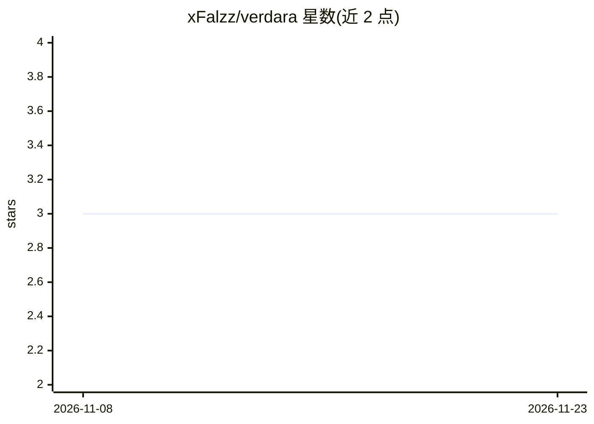

# xFalzz/verdara

⭐ 3 · TypeScript · NOASSERTION · 推送 2026-11-03 · [GitHub](https://github.com/xFalzz/verdara) · [官网](https://verdaraa.vercel.app) · 个人维护

**把住宅街区变成物理计算驱动的 3D 生态孪生平台**

Verdara 将住宅或街区照片转化为可交互的 3D 生态社区：先经零样本分割提取屋顶、落水管、透水地面与可回收物，再用确定性 TypeScript 模块按公开工程公式计算太阳能产量、雨水收集、渗井数量与循环经济估值，冻结为 SITE_BRIEF；三个专家 agent 仅作解释，其输出经数值防火墙校验（偏差 >3% 自动替换）。前端为 Next.js/Three.js，9 条路由含 3D 工作台、SAM 可视化与相机验证学院，需登录访问工程页面。

## 筛选速览

| 维度 | 判定 | 备注 |
|---|---|---|
| AI 角色 | `ai-native` | 本体是模型或模型工具 |
| 许可风险 | `none` | NOASSERTION |
| 部署形态 | `self-host` | docker 或自建部署 |
| 模型依赖 | — | README 未给出锁定关系 |
| 硬件要求 | — | 无带数字的原话,不猜 |
| 安装摩擦 | `low` | 无编译、无系统依赖或容器化 |
| 成熟度 | — | 结构信号不足 |

## 能力要点

- 感知→物理→审议→可视化的单向流水线，数字不来自语言模型
- 数值事实防火墙：AI 输出偏差超 3% 自动纠正并记审计日志
- 覆盖 195+ 国家的气候法线、电价、货币与电网碳强度
- 零资产 3D：程序化几何生成街区，无大体积模型下载

## 适用场景

- 评估自家屋顶的光伏潜力与雨水收集容量
- 规划街区级生态改造方案并查看前后对比
- 向社区展示暴雨情景下的径流消减效果

## 场景标签

`目标检测` `数据分析` · 领域:效率与自动化

## 证据(README 行号)

> L37: |**Perception**|Rooftops, downspouts, permeable soil, and recyclable materials are extracted from a user photo.|Met
> L45: - **Numeric fact firewall.** AI output whose figures drift more than 3.0% from the `SITE_BRIEF` is automatically co
> L79: |`/council`|3-Specialist AI Council|Auth required|Dr. Flora, Ir. Arka, and Sirkula analyze the `SITE_BRIEF`. All fi

## 星数曲线

2026-11-08 3 → 2026-11-23 3（+0）

---
*卡片 v1 · prompt 1.4 · 生成 2026-11-21 · 置信度 high · 依据 README sha `e0667ad9f12f` · [字段定义](../../DATASET.md)*
