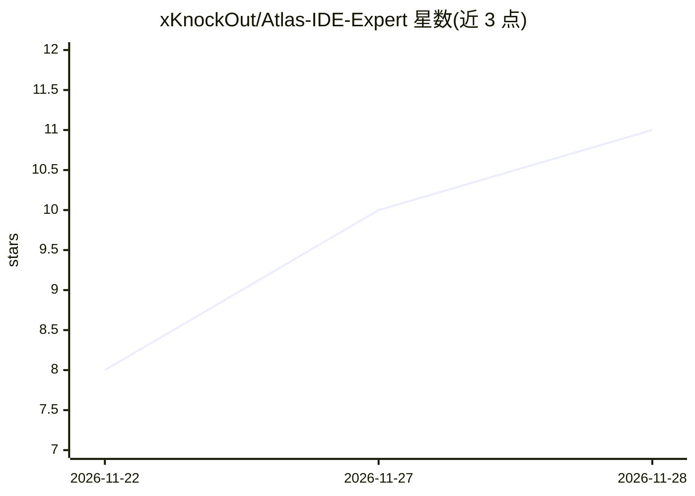

# xKnockOut/Atlas-IDE-Expert

⭐ 11 · Pascal · MIT · 推送 2026-11-27 · [GitHub](https://github.com/xKnockOut/Atlas-IDE-Expert) · 个人维护

**给 Delphi 开发者的 RAD Studio 插件：代码分析、补全与 MCP 接入**

面向 RAD Studio（Delphi/Object Pascal）的 IDE 插件，用自带窗口替换内置 Code Insight，提供 367 条检查规则的代码分析、代码补全、导航、重构、窗体支持、测试与调试辅助及欢迎页。数据来自自带的 Atlas server（LSP 语言服务器），可索引项目、独立作为 linter 运行，也可作为 MCP server 供 Claude Code 等 AI 助手调用。2.0 起由核心包 Atlas.IDE.Base 与 14 个按需安装的模块包组成。需要 RAD Studio 或 Delphi 12 及以上，发布页提供现成安装包，也可从源码构建。

## 筛选速览

| 维度 | 判定 | 备注 |
|---|---|---|
| AI 角色 | `ai-enhanced` | 去掉 AI 部分产品仍成立 |
| 许可风险 | `permissive` | MIT |
| 部署形态 | `desktop` | 安装包/桌面程序 |
| 模型依赖 | local-ok | 支持本地模型 |
| 硬件要求 | — | 无带数字的原话,不猜 |
| 安装摩擦 | `medium` | 含编译或系统依赖之一 |
| 成熟度 | — | 结构信号不足 |

## 能力要点

- 367 条检查规则的静态代码分析，输出 SARIF
- 自带 LSP 语言服务器，可脱离 IDE 作为 linter 运行
- MCP server 使 Claude Code 等 AI 客户端可在 IDE 内构建与修改文件
- 学习型补全建议（ghost text）无需 AI 与网络，另提供可选的 AI 补全与问题摘要

## 适用场景

- 在 Delphi 项目中获得更细的静态检查与批量修复
- 让 Claude Code 等 AI 助手通过 MCP 在 IDE 内操作构建与代码
- 独立于 IDE 对项目做 lint 检查

## 场景标签

 · 领域:开发工具/IDE 插件

## 证据(README 行号)

> L7: Atlas is an expert for RAD Studio (Delphi/Object Pascal). It replaces the built-in Code Insight with its own windows
> L52: |`Atlas.IDE.Assistants`|AI assistants: builds through `build_project` and changes to open files by MCP clients, own
> L69: - **AI ghost text (opt-in):** when no learned suggestion fits, Atlas can ask an AI provider after Enter (first prov

## 星数曲线

2026-11-22 8 → 2026-11-28 11（+3）

---
*卡片 v1 · prompt 1.4 · 生成 2026-11-22 · 置信度 high · 依据 README sha `1a3ef9d26dea` · [字段定义](../../DATASET.md)*
